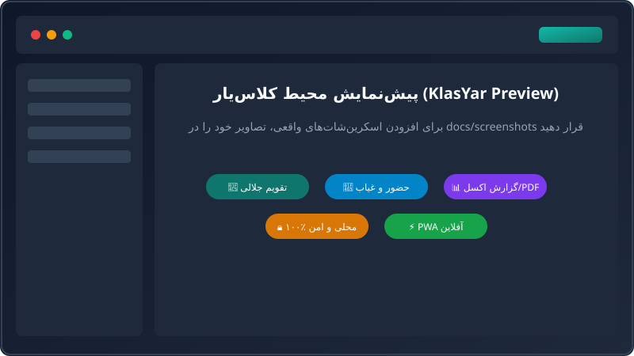
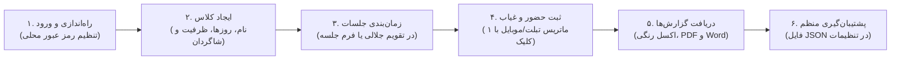

<div align="center">


# کلاس‌یار (KlasYar)

**سامانه هوشمند، آفلاین و لوکس مدیریت کلاس، جلسات آموزشی، حضور و غیاب و تقویم شمسی**

[](package.json)
[](LICENSE)
[](src/test)
[](https://react.dev/)
[](https://www.typescriptlang.org/)
[](https://vitejs.dev/)
[](https://dexie.org/)
[](public/manifest.json)

[معرفی](#-معرفی-کوتاه) • [ویژگی‌ها](#-فهرست-ویژگیها-features) • [راهنمای استفاده](#-راهنمای-استفاده-روزمره-گردش-کار-آموزشی) • [راهنمای به‌روزرسانی و ارتقا](#-راهنمای-بهروزرسانی-و-ارتقا-upgrade--maintenance-guide) • [شروع سریع](#-اجرای-سریع-quick-start) • [مستندات](#-مستندات-و-آموزشها)

</div>

---

## 📖 معرفی کوتاه

**کلاس‌یار** یک پلتفرم نسل جدید، مدرن و متمرکز بر حریم خصوصی برای **معلمان، اساتید دانشگاه، مشاوران تحصیلی و مدرسان خصوصی** است. این ابزار به مدرسان کمک می‌کند بدون وابستگی به اینترنت، پرداخت هزینه‌های ابری یا دغدغه کندی شبکه، برنامه هفتگی، جلسات درسی، حضور و غیاب دانش‌آموزان و گزارش‌های مدیریتی خود را به آسانی مدیریت کنند.

کلاس‌یار با رویکرد **Local-First (اولویت پردازش و ذخیره‌سازی محلی)** طراحی شده است؛ یعنی تمام داده‌ها در مرورگر اختصاصی خود کاربر در پایگاه‌داده قدرتمند IndexedDB ذخیره شده و هیچ داده‌ای به هیچ سرور ثانویه‌ای ارسال نمی‌شود.

---

## 📸 اسکرین‌شات‌ها و پیش‌نمایش (Screenshots)

<div align="center">
  
</div>

---

## ✨ فهرست ویژگی‌ها (Features)

| قابلیت | وضعیت | توضیحات فنی و کاربردی |
| :--- | :---: | :--- |
| 🔐 **احراز هویت ادمین محلی (Local Auth)** | ✅ | ثبت‌نام و ورود آفلاین با الگوریتم **PBKDF2 / SHA-256** به همراه Salt تصادفی، صفحه قفل سریع (Lock Screen)، محافظت از تمام روت‌ها و انقضای امن نشست |
| 📅 **تقویم شمسی جلالی تعاملی** | ✅ | نمای کامل ماهانه، تفکیک روزها، جمعه‌ها و تعطیلات رسمی، محاسبه ساعت تدریس با **پاپ‌اور انتخاب مستقیم سال و ماه** |
| 🎨 **موتور تم‌پذیری ۴ پالت لوکس** | ✅ | سوییچ بلادرنگ بین پالت‌های جذاب (**زمرد / Emerald**، **نیمه‌شب / Midnight**، **غروب / Sunset**، **تک‌رنگ / Monochrome**) |
| 🌌 **گوی نوری شناور و پس‌زمینه زنده (Floating Orb)** | ✅ | گوی نوری شناور و مدور مینیمال در پس‌زمینه با حفظ کنتراست تیره و شارپ کارت‌ها، افکت شیشه‌ای (**Glassmorphism**) و هاله نورانی تعاملی (`.glow-effect`) |
| ⏱️ **زمان‌سنج نوین (Modern TimePicker)** | ✅ | انتخابگر مدرن ساعت و دقیقه با ترنزیشن‌های حرکتی و پری‌ست‌های سریع (۱۵، ۳۰، ۴۵ دقیقه) با رندر اصلاح‌شده در پورتال مودال‌ها |
| 🗓️ **فیلتر بازه تاریخ جلالی** | ✅ | فیلتر هوشمند جلسات و گزارش‌ها بر اساس بازه تاریخ شمسی (از تاریخ تا تاریخ) |
| 📚 **مدیریت کلاس‌ها و دانش‌آموزان (CRUD)** | ✅ | ایجاد کلاس، تعیین سقف جلسات، روزهای برگزاری، ظرفیت، نام مرکز آموزشی و دفترچه اسامی دانش‌آموزان |
| 👥 **ماتریس مدرن حضور و غیاب** | ✅ | ثبت تک‌کلیک وضعیت حاضر، غایب، تاخیر، موجه با ماتریس تبلت/دسکتاپ و کارت‌های لمسی موبایل (با رفع کامل خطای React Hooks) |
| 📊 **خروجی چندگانه استایل‌دار** | ✅ | صدور **اکسل استایل‌دار رنگی (xlsx-js-style)**، **پی‌دی‌اف رسمی دوجهته با فونت وزیرمتن**، **ورد (DOCX)** و فایل پشتیبان **JSON** |
| 🌓 **تم سه‌حالته تیره / روشن / سیستم** | ✅ | بدون پرش نور سفید (No FOUC) با هماهنگی آنی کوکی و ویژگی‌های CSS Variables |
| 📱 **نصب‌پذیری PWA و کارکرد آفلاین** | ✅ | سازگاری ۱۰۰٪ با PWA برای نصب روی دسکتاپ (ویندوز، مک، لینوکس) و تلفن همراه (اندروید، iOS) |
| 🛡️ **پایداری، Error Boundary و تست‌ها** | ✅ | مرزبندی خطاها برای محافظت از رندر صفحه، پوشش **۸۳ آزمون خودکار موفق** با اجرای ۲ ثانیه‌ای |

---

## 🧭 راهنمای استفاده روزمره (گردش کار آموزشی)

کار با کلاس‌یار فوق‌العاده ساده، روان و سریع است:



1. **راه‌اندازی اولیه:** در اولین ورود، رمز عبور مدیریت محلی خود را تعیین کنید. این رمز فقط در دستگاه شما ذخیره شده و از اطلاعات دانش‌آموزان در برابر افراد غیرمجاز محافظت می‌کند.
2. **تعریف کلاس و شاگردان:** از بخش **کلاس‌ها**، یک کلاس جدید بسازید، روزهای برگزاری را تیک بزنید و اسامی دانش‌آموزان را اضافه کنید.
3. **مشاهده در تقویم:** وارد برگه **تقویم** شوید؛ جلسات به‌طور خودکار در تقویم شمسی جلالی چیده می‌شوند. با پاپ‌اور بالای صفحه می‌توانید فوراً به ماه‌ها یا سال‌های دیگر بپرید.
4. **ثبت حضور و غیاب:** در روز برگزاری کلاس، روی دکمه حضور و غیاب کلیک کنید. با ماتریس لمسی می‌توانید در چند ثانیه وضعیت کل کلاس (حاضر، غایب، تاخیر، موجه) را ثبت کنید.
5. **تهیه گزارش و کارنامه:** در بخش **گزارش‌ها**، گزارش ماهانه یا دوره‌ای را فیلتر کنید و با یک کلیک خروجی اکسل استایل‌دار با جدول‌های رنگی یا فایل پی‌دی‌اف رسمی دریافت نمایید.

---

## 🔄 راهنمای به‌روزرسانی و ارتقا (Upgrade & Maintenance Guide)

> **💡 سناریوی بسیار مهم:**  
> فرض کنید این پروژه رشد کند، امکانات متعددی به آن اضافه شود و نسخه‌های جدید (v0.4.0، v1.0.0 و ...) منتشر گردند؛ **چگونه باید کلاس‌یار را آپدیت کرد تا حتی ۱ بایت از اطلاعات کلاس‌ها و شاگردان از دست نرود؟**

### ۱. قانون طلایی: پشتیبان‌گیری پیش از هر ارتقا (JSON Backup)
اگرچه معماری کلاس‌یار طوری طراحی شده که هنگام آپدیت، اطلاعات مرورگر حذف نشوند، اما **همواره پیش از هر ارتقا یا جابه‌جایی دستگاه:**
- به منوی **تنظیمات** (`/settings`) بروید.
- تب **داده‌ها** را باز کنید.
- روی دکمه **«خروجی پشتیبان (Export JSON)»** کلیک کنید و فایل دانلودشده را در مکانی امن نگه دارید.

---

### ۲. به‌روزرسانی برای کاربران نسخه وب و PWA
اگر از کلاس‌یار روی وب یا به صورت اپلیکیشن نصب‌شده PWA استفاده می‌کنید:
1. صفحه را با فشردن کلیدهای **`Ctrl + F5`** (یا در مک **`Cmd + Shift + R`**) به‌صورت عمیق تازه‌سازی (Hard Reload) کنید.
2. در نسخه PWA، بنر «نسخه جدید در دسترس است» ظاهر می‌شود؛ با کلیک روی آن، Service Worker جدید فعال می‌گردد.
3. **داده‌های من کجاست؟** داده‌های شما در IndexedDB ذخیره هستند و ربطی به فایل‌های کش‌شده کلاینت ندارند؛ بنابراین با باز شدن نسخه جدید، موتور مهاجرت (Migration Engine) خودکار وارد عمل شده و داده‌ها را به ساختار جدید ارتقا می‌دهد.

---

### ۳. به‌روزرسانی برای توسعه‌دهندگان و سلف‌هاسترها (Self-Hosters)
اگر پروژه را از ریپازیتوری گیت کلون کرده‌اید، مراحل ارتقا به صورت زیر است:

```bash
# ۱. دریافت آخرین تغییرات نسخه جدید از شاخه اصلی
git pull origin main

# ۲. به‌روزرسانی و نصب پکیج‌های جدید احتمالی
npm install

# ۳. اجرای آزمون‌های خودکار جهت اطمینان از سلامت کامل کدبیس
npm test

# ۴. ساخت یا اجرای مجدد
npm run build     # برای نسخه نهایی استقرار
# یا
npm run dev       # برای اجرای محیط توسعه
```

---

### ۴. معماری ارتقای دیتابیس بدون از دست رفتن اطلاعات (Database Migration Strategy)
کلاس‌یار از موتور پیشرفته **Dexie.js** با سیستم نسخه مهاجرت استاندارد بهره می‌برد. تعاریف اسکیمای دیتابیس در فایل [`src/db/schema.ts`](src/db/schema.ts) قرار دارد:

```typescript
// src/db/schema.ts
export class KlasYarDatabase extends Dexie {
  constructor(name: string = DB_NAME) {
    super(name)

    // نسخه ۱ (پایه)
    this.version(1).stores({
      classDefinitions: "id, title, createdAt, updatedAt",
      sessions: "id, definitionId, date, [definitionId+date], status",
      attendance: "id, sessionId, studentId, status, &[sessionId+studentId]",
      settings: "key",
    })

    // نسخه ۲ (افزوده شدن جدول احراز هویت ادمین محلی)
    this.version(2).stores({
      users: "id, username",
    })

    // برای آپدیت‌های آینده در نسخه‌های v0.4.0+:
    // this.version(3).stores({
    //   notifications: "id, date, readStatus",
    // }).upgrade(tx => {
    //   // تبدیل خودکار داده‌های قدیمی به فرمت جدید بدون پاک شدن اطلاعات قبلی
    // })
  }
}
```

#### 🛡️ اصول ایمنی برای برنامه‌نویسان در نسخه‌های آینده:
1. **هرگز شماره نسخه‌های قبلی دیتابیس را ویرایش یا حذف نکنید.**
2. برای افزودن جدول یا ایندکس جدید، متغیر `DB_VERSION` را افزایش دهید (مثلاً از ۲ به ۳) و بلوک `this.version(3).stores(...)` را اضافه کنید.
3. در صورت تغییر شکل داده‌ها (Rename فیلد یا تغییر فرمت)، از تابع `.upgrade(tx => ...)` استفاده کنید تا سوابق حضور و غیاب گذشته کاربران به شکل خودکار تبدیل گردند.
4. با این شیوه، هر کاربری که برنامه را پس از ماه‌ها باز کند، مهاجرت گام‌به‌گام (از نسخه ۱ به ۲ و سپس ۳) به صورت بی‌صدا و بدون باگ انجام می‌پذیرد.

---

## ⚡ اجرای سریع (Quick Start)

تنها با ۳ دستور پروژه را روی سیستم خود کلون و اجرا کنید:

```bash
git clone https://github.com/DevRepoNull/klasyar.git
cd klasyar
npm install
npm run dev
```

سپس در مرورگر خود به آدرس **`http://localhost:5173`** بروید.

### اجرای آزمون‌ها (Test Suite):
پروژه مجهز به ۸۳ آزمون جامع با Vitest است:
```bash
npm test
```
تمامی تست‌ها در کمتر از ۲.۵ ثانیه اجرا شده و صحت منطق محاسباتی، چیدمان RTL، امنیت و گزارش‌ها را تأیید می‌کنند.

---

## 📚 مستندات و آموزش‌ها

کلاس‌یار دارای یکی از غنی‌ترین و مستندترین مخازن متن‌باز فارسی است:

- 🎓 **[آموزش‌های عمیق برنامه‌نویسی و معماری (Deep-Dive Tutorials)](docs/tutorials/README.md)**: ۵ مقاله آموزشی تخصصی از دیتابیس Dexie و تقویم شمسی جلالی تا حل چالش PDF فارسی و سیستم تم بدون پرش رنگ
- 📖 **[راهنمای شروع سریع و نصب گام‌به‌گام](docs/getting-started.md)**: راهنمای کامل نصب برای ویندوز، مک و لینوکس با تصاویر و جزئیات
- 🛠️ **[راهنمای جامع توسعه‌دهندگان](docs/developer-guide.md)**: ساختار درخت پروژه، الگوهای طراحی، لایه امنیت، مدل داده و راهنمای گام‌به‌گام افزودن فیچر
- 🏛️ **[مستندات معماری نرم‌افزار](docs/architecture.md)**: چرایی انتخاب فلسفه Local-First، تحلیل سبک‌سنگین معماری و استراتژی میگریشن
- 🚀 **[راهنمای استقرار و انتشار (Deployment)](docs/deployment.md)**: استقرار روی Vercel، Netlify، GitHub Pages، Cloudflare، Nginx و داکر
- 🤝 **[راهنمای مشارکت (Contributing)](CONTRIBUTING.md)**: راهنمای ایجاد Pull Request و استانداردهای کامیت
- 📜 **[تاریخچه نسخه‌ها و تغییرات (Changelog)](CHANGELOG.md)**: مستندات تمام نسخه‌ها بر مبنای استاندارد Keep a Changelog
- 🗺️ **[نقشه راه توسعه (Roadmap)](ROADMAP.md)**: مایلستون‌ها و چشم‌انداز تکاملی نرم‌افزار
- 🔒 **[سیاست‌های امنیتی (Security)](SECURITY.md)**: خط‌مشی گزارش آسیب‌پذیری‌ها و استانداردهای امنیتی

---

## 🛡️ حریم خصوصی داده‌ها (Where does my data live?)

> **«تمام داده‌ها در IndexedDB مرورگر اختصاصی خود شما نگهداری می‌شوند. هیچ فایلی به اینترنت یا سرورهای خارجی ارسال نمی‌شود. برای انتقال اطلاعات به سیستم دیگر، کافیست از قابلیت خروجی پشتیبان (Export JSON) استفاده کنید.»**

کلاس‌یار هیچ پایگاه‌داده سروری ندارد؛ اسامی دانش‌آموزان، یادداشت‌های خصوصی و وضعیت غیبت‌ها تنها در حافظه دستگاه شما ذخیره می‌گردند و بالاترین سطح حفظ حریم شخصی را برای اساتید و دانش‌آموزان فراهم می‌آورد.

---

## 🗺️ نقشه راه آینده (Roadmap Highlights)

- [x] **v0.1.0:** نسخه پایه تقویم شمسی، مدیریت کلاس و دانش‌آموزان، حضور و غیاب، گزارش‌های اکسل/پی‌دی‌اف/ورد
- [x] **v0.3.0:** بازطراحی کامل بصری، رفع باگ هوک در دیالوگ حضور، سیستم احراز هویت محلی PBKDF2، پالت‌های ۴ رنگ، افکت Aurora و انتخابگر سریع ماه/سال جلالی
- [ ] **v0.4.0:** شورت‌کات‌های کیبورد (`Ctrl+K` Command Palette)، اعلان‌های موعد جلسات و بسته‌بندی PWA پیشرفته
- [ ] **v0.5.0:** همگام‌سازی اختیاری ابری (Opt-in Cloud Sync با سرورهای اختصاصی PocketBase یا WebDAV)
- [ ] **v1.0.0:** بسته‌بندی اپلیکیشن نیتیو موبایل (Android APK و iOS با ابزار Capacitor) و پشتیبانی دوزبانه (i18n)

---

## 📄 مجوز (License)

این پروژه تحت مجوز متن‌باز **MIT** منتشر شده است. برای اطلاعات بیشتر فایل **[LICENSE](LICENSE)** را مطالعه کنید.

---

## ⭐ تشکر و حمایت

اگر کلاس‌یار به کار شما آمد یا برایتان مفید بود، لطفاً با دادن یک **⭐ (Star)** در بالای صفحه گیت‌هاب از توسعه این پروژه متن‌باز حمایت کنید!
