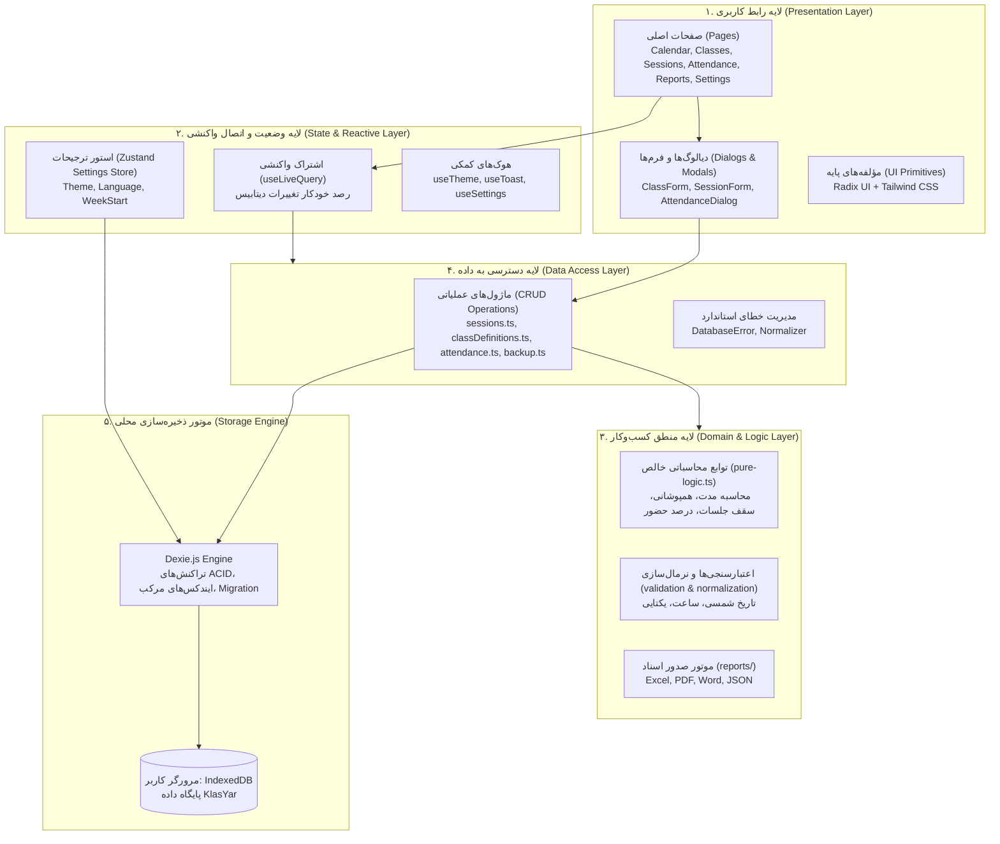
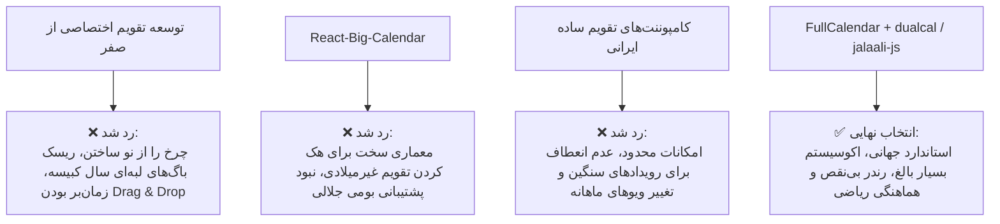
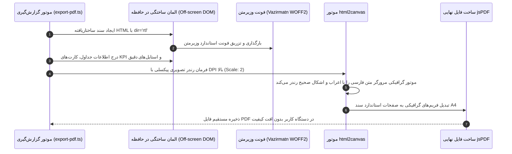

# سند معماری نرم‌افزار کلاس‌یار (Architecture Design Document)

> **خلاصه اجرایی:** این سند، معماری جامع فنی، تصمیمات زیرساختی، تحلیل سبک‌سنگین کردن گزینه‌ها (Trade-offs)، چالش‌های فنی بومی‌سازی زبان فارسی و نقشه راه تکاملی نرم‌افزار **کلاس‌یار (KlasYar)** را به عنوان یک سیستم مدرن و مستقل **مبتنی بر داده‌های محلی (Local-First)** تشریح می‌کند.

---

## فهرست مطالب

1. [نمای کلی معماری و لایه‌بندی سیستم](#۱-نمای-کلی-معماری-و-لایهبندی-سیستم)
2. [فلسفه Local-First: چرا نرم‌افزار بدون بک‌اند طراحی شد؟](#۲-فلسفه-local-first-چرا-نرمافزار-بدون-بکاند-طراحی-شد)
3. [چرا IndexedDB به جای localStorage؟ (تحلیل فنی)](#۳-چرا-indexeddb-به-جای-localstorage-تحلیل-فنی)
4. [معماری داده‌ی واکنشی: چرا Dexie.js و useLiveQuery؟](#۴-معماری-دادهی-واکنشی-چرا-dexiejs-و-uselivequery)
5. [ابزار بیلد و توسعه: چرا Vite به جای Create React App؟](#۵-ابزار-بیلد-و-توسعه-چرا-vite-به-جای-create-react-app)
6. [موتور تقویم: چرا ترکیب FullCalendar و محاسبات جلالی (dualcal / jalaali-js)؟](#۶-موتور-تقویم-چرا-ترکیب-fullcalendar-و-محاسبات-جلالی-dualcal--jalaali-js)
7. [چالش بزرگ PDF فارسی و راهکار DOM-to-Canvas](#۷-چالش-بزرگ-pdf-فارسی-و-راهکار-dom-to-canvas)
8. [تحلیل نقاط قوت، محدودیت‌ها و ریسک‌های معماری فعلی](#۸-تحلیل-نقاط-قوت-محدودیتها-و-ریسکهای-معماری-فعلی)
9. [نقشه راه تکامل معماری (Architectural Roadmap)](#۹-نقشه-راه-تکامل-معماری-architectural-roadmap)

---

## ۱. نمای کلی معماری و لایه‌بندی سیستم

کلاس‌یار بر اساس الگوی چندلایه‌ای و تفکیک‌شده (Layered Clean Architecture) پیاده‌سازی شده است. هیچ لایه‌ای به جز لایه دسترسی داده (Data Access Layer) مستقیماً به پایگاه داده دسترسی ندارد:



### اصول حاکم بر معماری:
- **جهت وابستگی‌ها:** وابستگی‌ها همواره از بالا به پایین است. منطق محاسباتی (`pure-logic.ts`) هیچ اطلاعی از کامپوننت‌های React یا IndexedDB ندارد و به عنوان توابع خالص (Pure Functions) توسعه یافته است.
- **تک‌منبع حقیقت (Single Source of Truth):** وضعیت پایدار تنها در IndexedDB زندگی می‌کند. هیچ کپی اضافی از رکوردها در استورهای میانی حافظه ذخیره نمی‌شود.
- **ارتباط رخدادمحور (Observable Pipeline):** تغییر در دیتابیس بدون دخالت لایه‌های میانی به صورت رویداد به کامپوننت‌ها مخابره می‌شود.

---

## ۲. فلسفه Local-First: چرا نرم‌افزار بدون بک‌اند طراحی شد؟

یکی از استراتژیک‌ترین تصمیمات در طراحی کلاس‌یار، عدم وابستگی به سرورهای سنتی و ساخت یک برنامه‌ی **مبتنی بر اولویت داده‌های محلی (Local-First)** است.

```
       معماری سنتی مبتنی بر کلود (Cloud-Centric)
       ┌───────────┐      اینترنت و API      ┌───────────────┐
       │ مرورگر کاربر │ ◄═══════════════════► │ سرور و دیتابیس │
       └───────────┘    (تاخیر شبکه، قطعی،      └───────────────┘
                        هزینه، ریسک امنیت)

       معماری کلاس‌یار (Local-First Architecture)
       ┌─────────────────────────────────────────────────────┐
       │                   دستگاه محلی کاربر                 │
       │  ┌───────────┐  ارتباط مستقیم دیسک  ┌─────────────┐  │
       │  │ رابط کاربری│ ◄══════════════════► │  IndexedDB  │  │
       │  └───────────┘      (۰ میلی‌ثانیه)   └─────────────┘  │
       └─────────────────────────────────────────────────────┘
```

### دلایل فنی و تجاری این تصمیم:
1. **حریم خصوصی حداکثری (Zero Knowledge & Full Privacy):**
   اسامی دانش‌آموزان، شماره‌های تماس احتمالی، وضعیت حضور و غیاب، و یادداشت‌های تدریس دبیران جزو داده‌های حساس آموزشی هستند. در این معماری، هیچ داده‌ای به هیچ سرور خارجی ارسال نمی‌شود و کنترل داده ۱۰۰٪ در دست کاربر است.
2. **عملکرد پایدار و بدون وابستگی به اینترنت (100% Offline Capability):**
   معلمان و مربیان در کلاس‌های درس، آموزشگاه‌ها یا نقاطی که دسترسی به اینترنت ضعیف یا قطع است، بدون هیچ تأخیری به برنامه دسترسی دارند و کارایی سیستم هرگز مختل نمی‌شود.
3. **سرعت و پاسخ‌دهی آنی (Zero Network Latency):**
   تمامی عملیات خواندن و نوشتن مستقیماً روی حافظه محلی دستگاه (NVMe/SSD) با سرعتی در مقیاس چند میلی‌ثانیه انجام می‌شود. نیاز به لودینگ‌های طولانی شبکه (Spinners) به کلی حذف شده است.
4. **هزینه عملیاتی صفر (Zero Server Maintenance Cost):**
   سیستم نیازی به پرداخت هزینه برای سرورهای ابری، پایگاه‌داده‌های مدیریت‌شده، سرویس‌های نگهداری کانتینرها (Docker/Kubernetes) و گواهی‌های دوره‌ای ندارد. نگهداری پروژه برای همیشه رایگان و پایدار است.

---

## ۳. چرا IndexedDB به جای localStorage؟ (تحلیل فنی)

بسیاری از اپلیکیشن‌های تحت وب ساده به اشتباه از `localStorage` برای ذخیره اطلاعات استفاده می‌کنند. جدول زیر تفاوت‌های بنیادین این دو فناوری را در یک سیستم مدیریت کلاس نشان می‌دهد:

| معیار مقایسه | `localStorage` | `IndexedDB` (انتخاب کلاس‌یار) |
| :--- | :--- | :--- |
| **سقف ظرفیت ذخیره‌سازی** | محدود به ۵ مگابایت (در بیشتر مرورگرها) | صدها مگابایت تا چند گیگابایت (بر اساس فضای دیسک سیستم) |
| **ماهیت اجرای عملیات I/O** | کاملاً همگام (**Synchronous و Blocking**) | کاملاً ناهمگام (**Asynchronous و Non-blocking**) |
| **تاثیر بر رندر UI** | خواندن و نوشتن سنگین باعث لرزش و قفل شدن فریم‌های UI می‌شود | اجرای ناهمگام در ترد جداگانه بدون افت فریم (60fps) |
| **ساختار ذخیره‌سازی داده** | فقط رشته‌های متنی ساده (Key-Value String) | اشیای غنی جاوااسکریپت، آرایه‌ها، باینری و Blobها |
| **قابلیت ایندکس‌گذاری** | ندارد؛ برای هر فیلتر باید کل داده Parse شود | ایندکس‌های تک، چندگانه و ایندکس‌های ترکیبی مرکب |
| **پشتیبانی از تراکنش‌های ACID** | ندارد؛ خرابی میان نوشتن داده‌ها را ناقص رها می‌کند | پشتیبانی کامل از Transactions برای حفظ یکپارچگی داده‌ها |

### جمع‌بندی تصمیم:
برای سیستمی که صدها جلسه، ماتریس حضور و غیاب شاگردان، تاریخ‌های شمسی و تنظیمات متعدد را مدیریت می‌کند، استفاده از `localStorage` منجر به سرریز ظرفیت (QuotaExceededError) و کندی شدید رابط کاربری می‌شد. IndexedDB تنها بستر استاندارد صنعتی برای نرم‌افزارهای دسکتاپ‌مانند وب است.

---

## ۴. معماری داده‌ی واکنشی: چرا Dexie.js و useLiveQuery؟

اگرچه IndexedDB بسیار قدرتمند است، اما کار مستقیم با API استاندارد W3C آن به شدت پردردسر است (Callback-based، کدهای تکراری، مدیریت دشوار Cursorها و عدم پشتیبانی از TypeScript).

```
         IndexedDB خام                 Dexie.js (پوشش مدرن)
    ┌──────────────────────┐         ┌──────────────────────┐
    │  • صدها خط کد زمخت   │         │  • توابع ساده Promise │
    │  • بدون Type-Safety  │  ════►  │  • کامپایلر تایپ‌اسکریپت│
    │  • مدیریت سخت نسخه   │         │  • اشتراک useLiveQuery│
    └──────────────────────┘         └──────────────────────┘
```

### مزایای انتخاب Dexie.js:
1. **پشتیبانی کامل از TypeScript:** تمامی جداول، کلیدهای اصلی و فیلدهای ایندکس به طور کامل تایپ‌سیف هستند (`Table<Session, string>`).
2. **مدیریت روان نسخه‌بندی دیتابیس (Schema Migrations):** در صورت تغییر ساختار جداول در آینده، Dexie امکان افزودن نسخه‌های بعدی (`db.version(2).stores(...)`) به همراه انتقال خودکار داده را فراهم می‌سازد.
3. **اشتراک داده‌های واکنشی با `useLiveQuery`:**
   به جای اینکه از کتابخانه‌های پیچیده کشینگ سرور مانند TanStack React Query استفاده کنیم و مجبور باشیم با کلیدهای کش درگیر شویم، Dexie دارای یک موتور مشاهده‌گر داخلی (Observable Hook) است. 
   
   به محض اینکه رکوردی در جدول `sessions` با تابع `db.sessions.add()` درج شود، موتور Dexie رویداد تغییر پایگاه‌داده را شنود کرده و تمام کامپوننت‌هایی که هوک `useLiveQuery` روی آن جدول دارند را در همان لحظه به‌روزرسانی می‌کند.

---

## ۵. ابزار بیلد و توسعه: چرا Vite به جای Create React App؟

پروژه‌های قدیمی با Create React App (CRA) و Webpack ساخته می‌شدند. کلاس‌یار از **Vite** بهره می‌برد:

1. **سرعت استارت اولیه و HMR (سرور توسعه):**
   - Webpack در شروع توسعه باید تمام صدها ماژول پروژه را از ابتدا باندل کند که در پروژه‌های بزرگ ثانیه‌ها طول می‌کشد.
   - Vite از ویژگی ماژول‌های بومی مرورگر (**Native ES Modules - ESM**) استفاده می‌کند. کدها بدون باندل شدن در لحظه در اختیار مرورگر قرار می‌گیرند و سرور در کمتر از ۳۰۰ میلی‌ثانیه آماده به کار است.
2. **ترنسپایل با موتور بسیار سریع esbuild:**
   Vite برای پردازش کدهای تایپ‌اسکریپت از `esbuild` که با زبان Go نوشته شده استفاده می‌کند که ۱۰ تا ۲۰ برابر سریع‌تر از ترنسپایلرهای سنتی مبتنی بر جاوااسکریپت است.
3. **خروجی بهینه بیلد نهایی با Rollup:**
   در بیلد نهایی (`npm run build`)، به طور خودکار استراتژی‌های Tree-Shaking و Chunk Splitting اعمال شده و کدهای کتابخانه‌های سنگین تفکیک می‌شوند.
4. **توقف پشتیبانی از CRA:**
   ابزار Create React App سال‌هاست توسط تیم توسعه رسماً رها شده و استانداردهای روز دنیای فرانت‌اند را پشتیبانی نمی‌کند.

---

## ۶. موتور تقویم: چرا ترکیب FullCalendar و محاسبات جلالی (dualcal / jalaali-js)؟

مدیریت تقویم و نمایش رویدادها، هسته‌ی اصلی تجربه‌ی کاربری کلاس‌یار است.

### بررسی گزینه‌های جایگزین و دلایل رد آنها:



### چرا این ترکیب انتخاب شد؟
- **FullCalendar:** بالغ‌ترین و قدرتمندترین کامپوننت تقویم جهان در فرانت‌اند با قابلیت رندر سریع رویدادها، ساختار ماژولار و دسترسی‌پذیری بالا.
- **الگوریتم ریاضی جلالی (`jalaali-js`):** این کتابخانه بر پایه الگوریتم محاسباتی استاد احمد بیرشک کار می‌کند و بدون وابستگی‌های سنگین، روزهای سال، جهش‌های کبیسه و تبدیل تقویم میلادی و شمسی را با دقت مطلق ریاضی محاسبه می‌نماید.
- **سفارشی‌سازی سبک FullCalendar برای RTL:** با استایل‌های اختصاصی در [`src/components/calendar/calendar.css`](../src/components/calendar/calendar.css)، تقویم به طور کامل از راست‌به‌چپ با روز اول هفته شنبه هماهنگ شده است.

---

## ۷. چالش بزرگ PDF فارسی و راهکار DOM-to-Canvas

تولید فایل PDF حاوی متون فارسی در محیط مرورگر بدون سرور، یکی از پیچیده‌ترین چالش‌های فنی در مهندسی وب است.

### ریشه مشکل چیست؟
موتورهای متداول وکتوری تولید PDF مانند `jsPDF` یا `pdfmake` برای الفبای لاتین که حروفی جدا از هم دارند طراحی شده‌اند. در زبان فارسی:
1. حروف بر اساس موقعیت در کلمه (اول، وسط، آخر، تنها) تغییر شکل می‌دهند (Glyph Shaping).
2. جهت نگارش راست‌به‌چپ است و ترکیب اعداد با متن فارسی نیازمند الگوریتم پیچیده دوجهته (BiDi - Bidirectional Text) است.
3. در صورت استفاده مستقیم از موتورهای برداری، متن «کلاس درس» به صورت معکوس و تکه‌تکه «س ا ل ک   س ر د» چاپ می‌شود یا حروف به علامت سوال (`???`) تبدیل می‌گردند.

### راهکار کلاس‌یار: رویکرد رندر دومرحله‌ای DOM-to-Canvas
برای حل قطعی این مسئله، از کتابخانه **`html2pdf.js`** همراه با استراتژی فونت توکار بهره گرفته شده است:



- **تضمین سلامت بصری:** چون رندر را موتور قدرتمند رندر متن خود مرورگر انجام می‌دهد، اتصال حروف، خط فارسی، تراز راست و فاصله‌ها دقیقاً مشابه ظاهر وب‌سایت و با کیفیتی عالی خلق می‌شوند.

---

## ۸. تحلیل نقاط قوت، محدودیت‌ها و ریسک‌های معماری فعلی

| بعد معماری | نقاط قوت (Strengths) | چالش‌ها و محدودیت‌ها (Trade-offs & Risks) |
| :--- | :--- | :--- |
| **ذخیره‌سازی** | سرعت فوق‌العاده، ظرفیت نامحدود، تراکنش‌پذیری | داده در داخل همان یک مرورگر قرار دارد؛ در صورت تعویض مرورگر نیاز به انتقال فایل پشتیبان است. |
| **امنیت و حریم شخصی** | صفر درصد امکان نشت داده از سمت سرور چون سروری وجود ندارد | اگر کاربر تاریخچه مرورگر را به طور کامل پاک کند (Clear All Browsing Data)، دیتابیس پاک خواهد شد (راهکار: بکاپ‌گیری دوره‌ای). |
| **همگام‌سازی (Sync)** | عدم ایجاد تعارض‌های شبکه (Conflict-Free) | در وضعیت فعلی، همگام‌سازی لحظه‌ای میان دو دستگاه مختلف (مثلاً موبایل و لپ‌تاپ دبیر) به صورت زنده وجود ندارد. |
| **وابستگی و هزینه** | استقرار ارزان و آسان روی هاست‌های ایستا (Static Hosting) | اجرای پردازش‌های پس‌زمینه در زمان بسته بودن تب مرورگر میسر نیست. |

---

## ۹. نقشه راه تکامل معماری (Architectural Roadmap)

برای نسخه‌های آتی نرم‌افزار کلاس‌یار، ارتقاهای معماری زیر برنامه‌ریزی شده است:

### ۱. تبدیل به برنامه پیش‌رونده وب (PWA)
- افزودن **Service Worker** جهت کش کامل فایل‌های CSS، جاوااسکریپت و فونت‌ها.
- قابلیت نصب روی صفحه اصلی سیستم‌عامل‌های Windows, macOS, Android و iOS با آیکون مستقل.
- باز شدن در پنجره اختصاصی بدون نوار آدرس مرورگر (Standalone Window).

### ۲. لایه همگام‌سازی اختیاری ابری (Optional Cloud Sync)
- طراحی یک آداپتور منعطف برای اتصال به سرورهای سبک مانند **PocketBase** یا **Supabase**.
- پیاده‌سازی رمزنگاری سرتاسری (**E2EE - End-to-End Encryption**): داده‌ها در دستگاه کاربر با کلید اختصاصی رمزگذاری شده و سپس به فضای ابری ارسال می‌شوند، به طوری که حتی سرور نیز قادر به خواندن اسامی شاگردان نخواهد بود.

### ۳. پشتیبانی از همگام‌سازی محلی P2P (بدون اینترنت)
- استفاده از بسترهای وب‌سوکت محلی یا WebRTC جهت انتقال آنی داده‌ها میان گوشی همراه و لپ‌تاپ در یک شبکه Wi-Fi محلی.

### ۴. ایمپورت گروهی شاگردان و برنامه‌ها
- ماژول هوشمند پردازش فایل‌های اکسل موجود آموزشگاه‌ها و تبدیل مستقیم آنها به جداول دیتابیس محلی.

---

## پیوند به سایر اسناد

- 📘 [**راهنمای توسعه‌دهندگان (docs/developer-guide.md)**](developer-guide.md): جزئیات راه‌اندازی، درخت پوشه‌ها، ساختار جداول و مثال‌های کد.
- 🚀 [**راهنمای شروع به کار (docs/getting-started.md)**](getting-started.md): راهنمای کار با سیستم و بخش‌های مختلف.
- 🤝 [**راهنمای مشارکت (CONTRIBUTING.md)**](../CONTRIBUTING.md): دستورالعمل ارسال Pull Request و کامیت‌ها.
