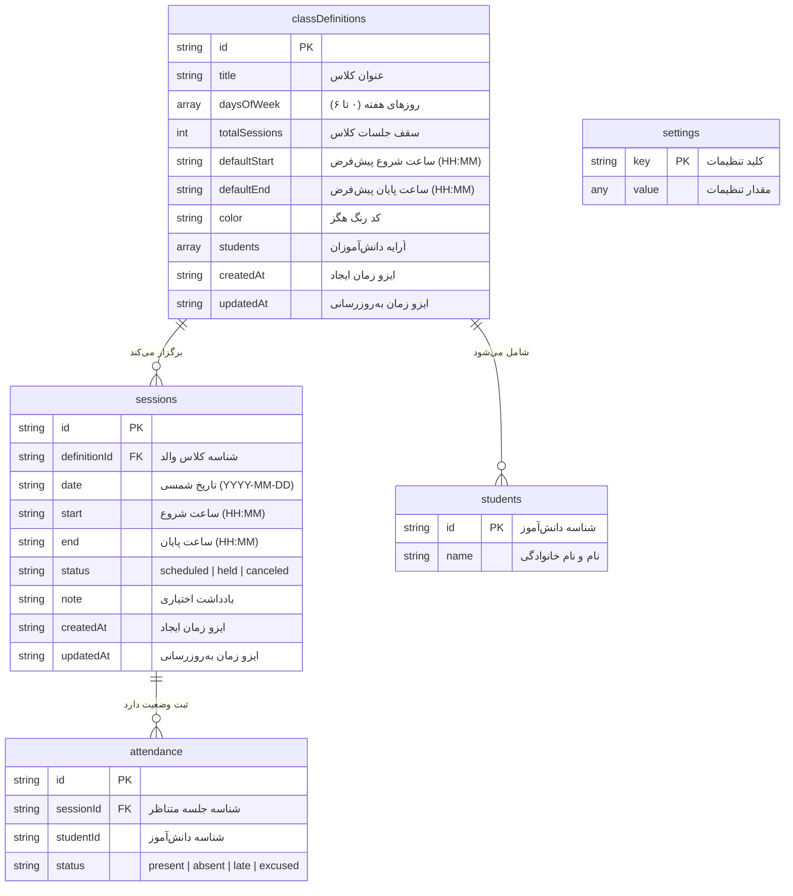
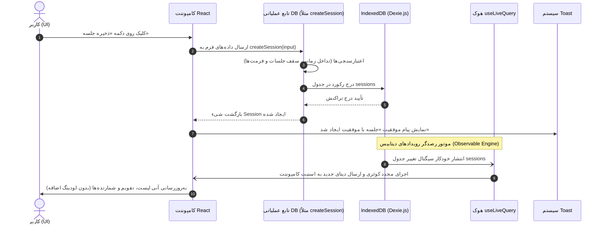
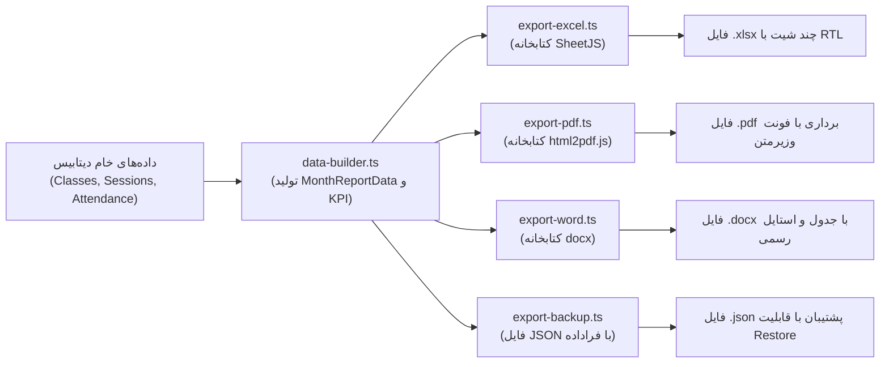
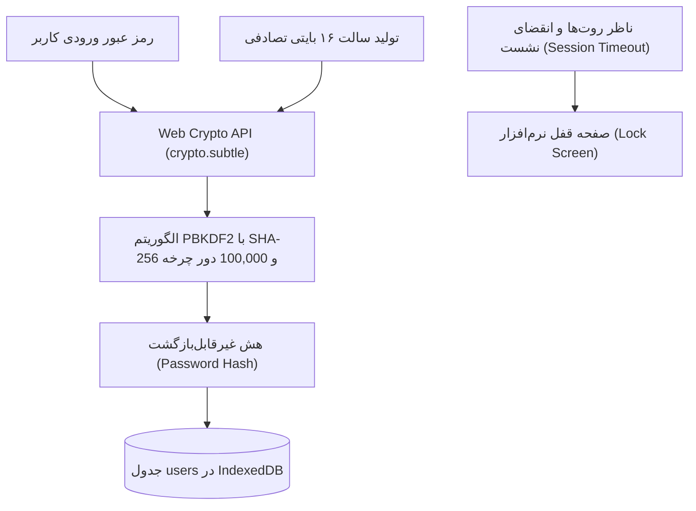

# راهنمای جامع توسعه‌دهندگان کلاس‌یار (Developer Guide)

> **هدف این سند:** فراهم‌سازی نقشه‌ی راه جامع و کاربردی برای هر توسعه‌دهنده‌ای که قصد دارد کدبیس **کلاس‌یار (KlasYar)** را درک کند، قابلیت‌های جدید به آن بیفزاید یا با ایجاد Pull Request در پروژه مشارکت نماید. پس از مطالعه‌ی این سند ظرف کمتر از ۳۰ دقیقه می‌توانید اولین تغییر معنادار خود را پیاده‌سازی و تست کنید.

---

## فهرست مطالب

1. [پشته فناوری (Tech Stack)](#۱-پشته-فناوری-tech-stack)
2. [ساختار پروژه و پوشه‌ها (Project Tree)](#۲-ساختار-پروژه-و-پوشهها-project-tree)
3. [مدل داده و پایگاه داده (Data Model & IndexedDB)](#۳-مدل-داده-و-پایگاه-داده-data-model--indexeddb)
4. [جریان داده و واکنش‌پذیری (Reactive Data Flow)](#۴-جریان-داده-و-واکنشپذیری-reactive-data-flow)
5. [استراتژی مدیریت وضعیت (State Management)](#۵-استراتژی-مدیریت-وضعیت-state-management)
6. [معماری مدیریت تم و جلوگیری از FOUC](#۶-معماری-مدیریت-تم-و-جلوگیری-از-fouc)
7. [قوانین کسب‌وکار و اعتبارسنجی‌ها (Validations)](#۷-قوانین-کسبوکار-و-اعتبارسنجیها-validations)
8. [موتور صدور گزارش‌ها (Export Engine)](#۸-موتور-صدور-گزارشها-export-engine)
9. [استراتژی تست و تضمین کیفیت (Testing)](#۹-استراتژی-تست-و-تضمین-کیفیت-testing)
10. [اسکریپت‌های پروژه (NPM Scripts)](#۱۰-اسکریپتهای-پروژه-npm-scripts)
11. [راهنمای گام‌به‌گام افزودن یک ویژگی جدید](#۱۱-راهنمای-گامبهگام-افزودن-یک-ویژگی-جدید)
12. [راهنمای گام‌به‌گام افزودن یک نوع خروجی جدید](#۱۲-راهنمای-گامبهگام-افزودن-یک-نوع-خروجی-جدید)
13. [استراتژی ارتقا، توسعه در مقیاس بالا و میگریشن دیتابیس (Database Migrations & Scaling)](#۱۳-استراتژی-ارتقا-توسعه-در-مقیاس-بالا-و-میگریشن-دیتابیس-database-migrations--scaling)
14. [معماری امنیت و احراز هویت محلی (Local-First Authentication)](#۱۴-معماری-امنیت-و-احراز-هویت-محلی-local-first-authentication)
15. [قراردادها و استانداردهای کدنویسی (Code Conventions)](#۱۵-قراردادها-و-استانداردهای-کدنویسی-code-conventions)
16. [پیوندها و مستندات تکمیلی](#۱۶-پیوندها-و-مستندات-تکمیلی)

---

## ۱. پشته فناوری (Tech Stack)

کلاس‌یار از پشته‌ای مدرن، تماماً کلاینت‌ساید (Client-Side Only) و فاقد وابستگی به سرور بهره می‌برد:

| نام ابزار / فریم‌ورک | نسخه | نقش در پروژه | پیوند مستندات رسمی |
| :--- | :---: | :--- | :--- |
| **React** | `18.3.1` | کتابخانه اصلی ساخت رابط کاربری ماژولار و واکنشی | [react.dev](https://react.dev) |
| **TypeScript** | `5.6.3` | سیستم Type-Safety سفت‌وسخت در سراسر پروژه | [typescriptlang.org](https://www.typescriptlang.org/docs) |
| **Vite** | `5.4.11` | ابزار بیلد فوق‌سریع و سرور توسعه با HMR آنی | [vitejs.dev/guide](https://vitejs.dev/guide) |
| **Tailwind CSS** | `3.4.15` | فریم‌ورک Utility-First استایل‌دهی با پشتیبانی از RTL | [tailwindcss.com/docs](https://tailwindcss.com/docs) |
| **shadcn/ui & Radix UI** | `^1.1.x` | مؤلفه‌های دسترسی‌پذیر، بدون استایل تحمیلی (Headless) | [ui.shadcn.com](https://ui.shadcn.com) / [radix-ui.com](https://www.radix-ui.com) |
| **Framer Motion** | `11.11.17` | انیمیشن‌های روان تغییر مسیر و باز و بسته شدن دیالوگ‌ها | [framer.com/motion](https://www.framer.com/motion) |
| **Lucide React** | `0.460.0` | مجموعه آیکون‌های برداری بهینه‌سازی‌شده برای وب | [lucide.dev](https://lucide.dev) |
| **Dexie.js** | `4.4.7` | پوشش شیءگرای با کارایی بالا روی IndexedDB مرورگر | [dexie.org](https://dexie.org) |
| **dexie-react-hooks** | `4.4.0` | ایجاد اشتراک واکنشی (`useLiveQuery`) میان دیتابیس و React | [dexie.org/docs/libs/dexie-react-hooks](https://dexie.org/docs/libs/dexie-react-hooks) |
| **dexie-export-import** | `4.4.2` | درون‌ریزی و برون‌بری ساختاریافته‌ی دیتابیس به فرمت JSON | [dexie.org/docs/ExportImport](https://dexie.org/docs/ExportImport/dexie-export-import) |
| **Zustand** | `5.1.0` | مدیریت وضعیت سبک‌وزن برای تم و تنظیمات کاربری | [zustand.docs.pmnd.rs](https://zustand.docs.pmnd.rs) |
| **FullCalendar** | `6.1.22` | موتور رندر تقویم ماهانه و تعامل با ایونت‌ها | [fullcalendar.io](https://fullcalendar.io) |
| **jalaali-js** | `2.0.1` | محاسبات تقویم دقیق هجری شمسی و تبدیل میلادی-جلالی | [github.com/jalaali/jalaali-js](https://github.com/jalaali/jalaali-js) |
| **SheetJS (xlsx)** | `0.18.5` | تولید فایل‌های اکسل ساختاریافته چندبرگی با جهت RTL | [sheetjs.com](https://sheetjs.com) |
| **xlsx-js-style** | `1.2.0` | استایل‌دهی سلول‌ها، حاشیه‌ها و رنگ‌بندی سازمانی شیت‌های اکسل | [npmjs.com/package/xlsx-js-style](https://www.npmjs.com/package/xlsx-js-style) |
| **html2pdf.js** | `0.14.0` | رندر اسناد HTML با فونت وزیرمتن به فایل وکتوری/کانواس PDF | [ekoopmans.github.io/html2pdf.js](https://ekoopmans.github.io/html2pdf.js) |
| **docx** | `9.15.3` | ساخت پویای اسناد مایکروسافت ورد (.docx) بدون نیاز به Office | [docx.js.org](https://docx.js.org) |
| **Web Crypto API** | Native | احراز هویت محلی با رمزنگاری PBKDF2 و هش SHA-256 و Salt رندوم | [w3.org/TR/WebCryptoAPI](https://www.w3.org/TR/WebCryptoAPI/) |
| **react-hot-toast** | `2.6.1` | نمایش اعلان‌های اطلاع‌رسانی، موفقیت و خطاهای پایگاه داده | [react-hot-toast.com](https://react-hot-toast.com) |
| **Vitest** | `2.1.9` | موتور مدرن اجرای تست‌های واحد فوق‌سریع هماهنگ با Vite (۸۳ آزمون پاس‌شده) | [vitest.dev](https://vitest.dev) |

---

## ۲. ساختار پروژه و پوشه‌ها (Project Tree)

پروژه به صورت ماژولار و مبتنی بر تفکیک دقیق وظایف (Separation of Concerns) سازمان‌دهی شده است:

```
klasyar/
├── public/                       # فایل‌های استاتیک بدون نیاز به باندل
│   ├── favicon.svg               # نماد بارگذاری تب مرورگر
│   ├── logo.svg                  # لوگوی اختصاصی کلاس‌یار
│   └── fonts/
│       └── Vazirmatn-Variable.woff2 # فونت وزیرمتن با لود زودهنگام (Preloaded)
├── src/
│   ├── components/               # کامپوننت‌های رابط کاربری (UI)
│   │   ├── app-link.tsx          # لینک‌های SPA بدون بارگذاری مجدد صفحه
│   │   ├── attendance/           # دیالوگ‌ها و مؤلفه‌های حضور و غیاب
│   │   │   ├── attendance-constants.ts   # برچسب‌ها و رنگ‌های وضعیت حضور
│   │   │   ├── attendance-matrix.tsx     # ماتریس لمسی ثبت حضور برای دسکتاپ و کارت‌های موبایل
│   │   │   └── session-attendance-dialog.tsx # فرم ثبت حضور شاگردان در جلسه (با رفع Rules of Hooks)
│   │   ├── calendar/             # ماژول تقویم و رویدادهای ماهانه
│   │   │   ├── calendar.css      # سفارشی‌سازی استایل‌های FullCalendar برای RTL
│   │   │   ├── session-chip.tsx  # چیپ گرافیکی جلسه روی خانه‌های تقویم
│   │   │   ├── session-day-panel.tsx     # سایدبار جزئیات جلسات یک روز خاص
│   │   │   └── session-dialogs.tsx       # دیالوگ ایجاد و ویرایش جلسه در تقویم
│   │   ├── classes/              # ماژول تعریف و مدیریت کلاس‌ها
│   │   │   ├── class-card.tsx    # کارت بصری نمایش آمار کلاس و میانگین حضور
│   │   │   ├── class-form-dialog.tsx     # فرم افزودن/ویرایش کلاس و شاگردان
│   │   │   ├── class-palette.ts  # پالت رنگی استاندارد برای تگ کلاس‌ها
│   │   │   └── delete-class-dialog.tsx   # تاییدیه حذف آبشاری کلاس و جلسات
│   │   ├── layout/               # قالب کلی و پیمایش
│   │   │   ├── AppFooter.tsx     # پاورقی سازمانی نمایش وضعیت محلی و نسخه
│   │   │   ├── AppLayout.tsx     # لایه‌بندی کلی، سایدبار دسکتاپ، منوی موبایل و هدر
│   │   │   └── nav-items.ts      # منوهای پیمایش و آیکون‌های متناظر
│   │   ├── onboarding/           # ماژول راهنمای تعاملی و آنبوردینگ کاربر
│   │   │   └── onboarding-wizard.tsx     # ویزارد خوش‌آمدگویی و راه‌اندازی اولیه
│   │   ├── sessions/             # مدیریت متمرکز فهرست جلسات
│   │   │   └── session-form-dialog.tsx   # فرم افزودن و ویرایش جلسات با تایم‌پیکر نوین
│   │   ├── settings/             # مؤلفه‌های بخش تنظیمات
│   │   │   ├── account-profile-tab.tsx   # مدیریت حساب کاربری ادمین، تغییر رمز و خروج
│   │   │   ├── color-theme-picker.tsx    # انتخابگر بلادرنگ پالت‌های ۴گانه لوکس
│   │   │   ├── restore-backup-dialog.tsx # بررسی صحت و بازگردانی فایل JSON
│   │   │   ├── settings-section.tsx      # کارت‌های ساختاریافته تنظیمات
│   │   │   └── theme-mode-switch.tsx     # دکمه انتخاب حالت تیره، روشن یا سیستم
│   │   └── ui/                   # مؤلفه‌های پایه طراحی بر مبنای Radix UI
│   │       ├── aurora-background.tsx     # پس‌زمینه ارگانیک شفق قطبی متصل به تم
│   │       ├── badge.tsx         # نشان‌ها و برچسب‌های رنگی
│   │       ├── button.tsx        # دکمه با واریانت‌های بصری و افکت درخشش (.glow-effect)
│   │       ├── card.tsx          # کانتینرهای پنلی Glassmorphism
│   │       ├── dialog.tsx        # پنجره‌های مدال دسترسی‌پذیر و پورتال‌های ایمن
│   │       ├── error-boundary.tsx # مرزبندی هوشمند برای مهار خطاهای رندر UI
│   │       ├── input.tsx         # فیلد ورودی متن
│   │       ├── jalali-date-picker.tsx # تقویم جلالی با انتخابگر سریع سال و ماه
│   │       ├── preloader.tsx     # نشانگر پیش‌بارگذاری روان
│   │       ├── select.tsx        # دراپ‌داون‌های انتخاب تک‌گزینه‌ای
│   │       ├── switch.tsx        # تاگل‌سوئیچ‌های روشن/خاموش
│   │       ├── tabs.tsx          # زبانه‌های جابه‌جایی تب
│   │       ├── time-picker.tsx   # زمان‌سنج نوین با انیمیشن و پری‌ست‌های سریع
│   │       ├── toast.tsx / toaster.tsx # سیستم اعلان‌های Radix
│   │       └── tooltip.tsx       # راهنماهای شناور موس
│   ├── db/                       # لایه پایگاه داده محلی (Dexie / IndexedDB)
│   │   ├── schema.ts             # اسکیمای کامل دیتابیس (نسخه ۲)، ایندکس‌ها و تایپ‌ها
│   │   ├── classDefinitions.ts   # توابع CRUD و منطق کلاس‌ها و شاگردان
│   │   ├── sessions.ts           # توابع CRUD جلسات، اعتبارسنجی تداخل و سقف
│   │   ├── attendance.ts         # مدیریت رکوردهای حضور، ماتریس غیبت و آمار
│   │   ├── settings.ts           # ذخیره‌سازی ترجیحات در جدول پایگاه داده
│   │   ├── hooks.ts              # هوک‌های واکنشی useLiveQuery برای خواندن داده‌ها
│   │   ├── errors.ts             # کلاس استاندارد DatabaseError و هندلر خطاها
│   │   └── seed.ts               # تولید داده‌های نمایشی اولیه (Mock Data)
│   ├── hooks/                    # هوک‌های عمومی و میان‌برهای سیستم
│   │   ├── use-theme.ts          # اشتراک با وضعیت تم جاری
│   │   ├── use-toast.ts          # ارسال پیام‌های آنی به کاربر
│   │   └── use-settings.ts       # دسترسی سریع به تنظیمات پیکربندی‌شده
│   ├── lib/                      # ابزارها و توابع کمکی کاربردی
│   │   ├── auth.ts               # رمزنگاری PBKDF2/SHA-256 و اعتبارسنجی نشست محلی
│   │   ├── backup.ts             # تولید فایل بکاپ امن JSON و اعتبارسنجی آن
│   │   ├── color-theme.ts        # مدیریت پالت‌های ۴ رنگ و تزریق متغیرهای CSS
│   │   ├── date.ts               # ابزارهای عمومی تاریخ
│   │   ├── font.ts               # بارگذاری و کش فونت وزیرمتن برای PDF
│   │   ├── idbStorage.ts         # درایور ذخیره‌سازی سفارشی Zustand در IndexedDB
│   │   ├── jalali.ts             # موتور تبدیل تقویم، فرمت فارسی و روزهای هفته
│   │   ├── notifications.ts      # سامانه یادآوری مرورگر و هشدارهای سررسید جلسه
│   │   ├── pure-logic.ts         # توابع محاسباتی خالص، تست‌پذیر و بدون ساید‌افکت
│   │   ├── router.ts             # مسیریابی ساده و سریع SPA بر پایه Hash Routing
│   │   ├── theme.ts              # اعمال کلاس dark، هماهنگی با مدیا و کوکی آینه
│   │   ├── utils.ts              # ابزار ادغام کلاس‌های Tailwind (cn / clsx / twMerge)
│   │   └── reports/              # موتور پردازش و صدور انواع خروجی
│   │       ├── data-builder.ts   # تجمیع داده‌ها، شاخص‌های KPI و ماتریس ماهانه
│   │       ├── export-excel.ts   # صدور گزارش به فرمت اکسل استایل‌دار (xlsx-js-style)
│   │       ├── export-pdf.ts     # صدور گرافیکی گزارش به PDF با فونت وزیرمتن
│   │       ├── export-word.ts    # صدور گزارش رسمی به فرمت مایکروسافت ورد (DOCX)
│   │       ├── export-backup.ts  # پشتیبان‌گیری سریع
│   │       └── types.ts          # تایپ‌های مرتبط با گزارش‌ها و خروجی‌ها
│   ├── pages/                    # ویوهای اصلی نرم‌افزار
│   │   ├── auth-page.tsx         # صفحه خوش‌آمدگویی، ورود و قفل برنامه
│   │   ├── calendar-page.tsx     # نمای ماهانه تقویم با انتخابگر سال/ماه شمسی
│   │   ├── classes-page.tsx      # فهرست کارت‌های کلاس و افزودن کلاس جدید
│   │   ├── sessions-page.tsx     # جدول فیلترپذیر تمام جلسات با فیلتر بازه تاریخ جلالی
│   │   ├── attendance-page.tsx   # ماتریس ماهانه حضور شاگردان و ثبت وضعیت
│   │   ├── reports-page.tsx      # داشبورد آماری، نمودار حضور و صدور فایل‌ها
│   │   ├── settings-page.tsx     # پیکربندی تم، رنگ‌ها، امنیت، اعلان‌ها و پشتیبان
│   │   ├── help-page.tsx         # صفحه راهنما، آموزش و کلیدهای میان‌بر
│   │   └── placeholder-pages.tsx # صفحات موقت و پیام‌های راهنما
│   ├── store/                    # مدیریت استیت کلاینت با Zustand
│   │   ├── authStore.ts          # استور وضعیت احراز هویت و قفل کاربر
│   │   └── settingsStore.ts      # استور تنظیمات کاربر متصل به IndexedDB
│   ├── test/                     # آزمون‌های واحد و یکپارچگی با Vitest (۸۳ تست)
│   │   ├── app-footer.test.ts
│   │   ├── attendance-error-boundary.test.ts
│   │   ├── aurora-glow.test.ts
│   │   ├── color-theme.test.ts
│   │   ├── help-onboarding.test.ts
│   │   ├── help-search-qa.test.ts
│   │   ├── local-auth.test.ts
│   │   ├── pure-logic.test.ts
│   │   ├── reports-export-style.test.ts
│   │   ├── reports-filter.test.ts
│   │   ├── responsive-qa.test.ts
│   │   ├── rtl-layout-qa.test.ts
│   │   └── session-improvements-qa.test.ts
│   ├── App.tsx                   # کامپوننت ریشه، ارائه‌دهنده قالب و روتر
│   ├── index.css                 # توکن‌های رنگی HSL برای حالت روشن و تیره
│   └── main.tsx                  # نقطه ورود اپلیکیشن و اتصال به DOM
├── docs/                         # مستندات فنی و آموزشی
│   ├── architecture.md           # تحلیل عمیق معماری، تصمیمات فنی و نقشه راه
│   ├── developer-guide.md        # این سند راهنما
│   ├── getting-started.md        # راهنمای کاربری و شروع سریع
│   ├── deployment.md             # راهنمای استقرار روی سرورهای ایستا
│   ├── screenshots/              # تصاویر و پیش‌نمایش‌های بصری
│   └── tutorials/                # مقالات آموزشی عمیق کدبیس (Deep-Dive)
├── .github/                      # قالب‌ها و ورک‌فلوهای CI/CD گیت‌هاب
├── CHANGELOG.md                  # تاریخچه تغییرات و نسخه‌ها
├── CONTRIBUTING.md               # راهنمای جامع مشارکت‌کنندگان
├── CODE_OF_CONDUCT.md           # مرام‌نامه اخلاقی مشارکت‌کنندگان
├── LICENSE                       # مجوز متن‌باز (MIT)
├── README.md                     # صفحه اصلی و معرفی پروژه
├── ROADMAP.md                    # نقشه راه آینده
├── SECURITY.md                   # خط‌مشی گزارش آسیب‌پذیری‌های امنیتی
├── package.json                  # تعاریف وابستگی‌ها و اسکریپت‌ها
├── tailwind.config.ts            # تنظیمات تم، پالت رنگ، انیمیشن‌ها و RTL
├── tsconfig.json                 # تنظیمات کامپایلر تایپ‌اسکریپت و path alias (@/*)
└── vite.config.ts                # پیکربندی سرور Vite و حل آدرس‌ها
```

---

## ۳. مدل داده و پایگاه داده (Data Model & IndexedDB)

پایگاه داده برنامه‌ی کلاس‌یار بر پایه‌ی **Dexie.js** نسخه ۴ پیاده‌سازی شده و نام آن در مرورگر `klasyar` است.

### نمودار رابطه موجودیت‌ها (ER Diagram)



### ساختار جداول و ایندکس‌ها در Dexie

تعریف اسکیمای دیتابیس در فایل [`src/db/schema.ts`](../src/db/schema.ts) قرار دارد:

```typescript
export const DB_VERSION = 2

this.version(1).stores({
  classDefinitions: "id, title, createdAt, updatedAt",
  sessions: "id, definitionId, date, [definitionId+date], status",
  attendance: "id, sessionId, studentId, status, &[sessionId+studentId]",
  settings: "key",
})

this.version(2).stores({
  users: "id, username",
})
```

#### ۱. جدول `classDefinitions` (کلاس‌ها)
- **کلید اصلی:** `id` (رشته تصادفی یکتا تولیدشده توسط UUID)
- **ایندکس‌ها:** `title`, `createdAt`, `updatedAt` برای سورت و فیلتر
- **فیلد آرایه‌ای `students`:** شامل اشیای `{ id: string, name: string }` که به عنوان بخشی از خود رکورد کلاس ذخیره می‌شوند.

#### ۲. جدول `sessions` (جلسات آموزشی)
- **کلید اصلی:** `id`
- **ایندکس‌ها:**
  - `definitionId`: جهت بازیابی فوری تمامی جلسات متعلق به یک کلاس
  - `date`: جهت کوئری‌های بازه زمانی تقویم
  - `[definitionId+date]`: ایندکس ترکیبی بسیار سریع برای استعلام جلسات یک کلاس خاص در تاریخی مشخص
  - `status`: فیلتر سریع بر اساس وضعیت (برنامه‌ریزی‌شده، برگزارشده، لغوشده)

#### ۳. جدول `attendance` (حضور و غیاب)
- **کلید اصلی:** `id`
- **ایندکس‌ها:** `sessionId`, `studentId`, `status`
- **ایندکس یکتای ترکیبی `&[sessionId+studentId]`:**
  این ایندکس حیاتی تضمین می‌کند در سطح موتور دیتابیس تحت هیچ شرایطی برای یک دانش‌آموز در یک جلسه بیش از یک رکورد حضور ثبت نشود.

#### ۴. جدول `settings` (تنظیمات سراسری)
- **کلید اصلی:** `key`
- نگهداری کلید-مقدارهای متفرقه و پایداری استور تنظیمات.

#### ۵. جدول `users` (احراز هویت ادمین محلی)
- **کلید اصلی:** `id`
- **ایندکس‌ها:** `username`
- نگهداری هش رمز عبور تولیدشده با الگوریتم **PBKDF2**، سالت تصادفی و فراداده‌های امنیتی برای محافظت از داده‌های معلمان.

---

## ۴. جریان داده و واکنش‌پذیری (Reactive Data Flow)

یکی از مدرن‌ترین و تمیزترین ویژگی‌های معماری کلاس‌یار، استفاده از **الگوی جریان واکنشی داده (Reactive Architecture)** است:



### چرا این الگو برتر است؟
1. **حذف کامل Refetch دستی:** نیازی به پاس دادن متدهای `refetch()` یا `callback` در میان کامپوننت‌های تو در تو نیست.
2. **حذف Cache Invalidation دستی:** برخلاف ابزارهایی مانند React Query یا RTK Query که باید کلیدهای کش (`invalidateQueries`) را به صورت دستی مدیریت کنید، Dexie مستقیماً تغییرات سطح دیسک را مانیتور کرده و تنها کامپوننت‌های مشترک را دوباره رندر می‌کند.
3. **همگام‌سازی تضمین‌شده چندتبی:** اگر کاربر کلاس‌یار را در دو پنجره یا تب مختلف مرورگر باز کند، هر تغییری در تب اول بلافاصله در تب دوم نیز در لحظه منعکس می‌شود.

---

## ۵. استراتژی مدیریت وضعیت (State Management)

در کلاس‌یار هیچ «تک‌وضعیت غول‌آسا» (Single Monolithic Store مانند یک Redux عظیم) وجود ندارد. تفکیک دقیق مسئولیت‌ها به شکل زیر است:

```
┌─────────────────────────────────────────────────────────────┐
│                       لایه‌های State                         │
├──────────────────────────┬──────────────────────────────────┤
│ ۱. داده‌های پایدار کسب‌وکار│ Dexie.js (IndexedDB)             │
│   (کلاس‌ها، جلسات، حضورها)  │ خواندن با useLiveQuery           │
├──────────────────────────┼──────────────────────────────────┤
│ ۲. ترجیحات عمومی و تم    │ Zustand Store                    │
│   (Theme, Language, ...) │ با Persist Middleware سفارشی IDB  │
├──────────────────────────┼──────────────────────────────────┤
│ ۳. وضعیت‌های گذرای UI    │ React useState / useReducer      │
│   (مقادیر فرم، بازبودن مودال)│ به صورت محلی در خود کامپوننت     │
└──────────────────────────┴──────────────────────────────────┘
```

1. **داده‌های دامنه‌ای (Domain Data):**
   تنها منبع حقیقت (Single Source of Truth) جداول IndexedDB هستند. تغییرات با توابع [`src/db/sessions.ts`](../src/db/sessions.ts) و [`src/db/classDefinitions.ts`](../src/db/classDefinitions.ts) انجام شده و با هوک‌های [`src/db/hooks.ts`](../src/db/hooks.ts) خوانده می‌شوند.

2. **تنظیمات و ترجیحات (Application Preferences):**
   استور [`src/store/settingsStore.ts`](../src/store/settingsStore.ts) وضعیت تم، اعلان‌ها و روز شروع هفته را نگهداری می‌کند. این استور از طریق درایور اختصاصی [`src/lib/idbStorage.ts`](../src/lib/idbStorage.ts) در جدول `settings` دیتابیس پایدار می‌شود.

3. **وضعیت‌های موضعی (Transient State):**
   استیت‌های مربوط به کنترل فیلدهای فرم، نمایش دیالوگ‌ها یا لودینگ دکمه‌ها صرفاً با `useState` محلی مدیریت می‌شوند تا از رندرهای بیهوده‌ی سراسری جلوگیری شود.

---

## ۶. معماری مدیریت تم و جلوگیری از FOUC

یکی از معضلات رایج در برنامه‌های کلاینت‌ساید و Single Page Applications که تنظیمات تم را در IndexedDB (که غیرهمگام است) نگه می‌دارند، پدیده‌ی **پرش تصویر با تم اشتباه (Flash of Unstyled Content یا FOUC)** در لحظه‌ی باز شدن صفحه است.

کلاس‌یار این مسئله را با یک استراتژی هوشمندانه و دومرحله‌ای حل کرده است:

```
[درخواست کاربر برای باز کردن صفحه]
                 │
                 ▼
     ┌────────────────────────┐
     │  اسکریپت همگام Inline   │ ◄── خواندن کوکی klasyar-theme به صورت کاملاً همگام
     │      در index.html     │ ◄── بررسی matchMedia("(prefers-color-scheme: dark)")
     └───────────┬────────────┘
                 │
                 ├─► اگر Dark بود: اعمال کلاس 'dark' روی <html> پیش از ترسیم پیکسل‌ها
                 └─► اگر Light بود: اطمینان از حذف کلاس 'dark'
                 │
                 ▼
        [رندر کامل اولین فریم] ──► بدون کوچکترین پرش نور سفید یا سیاه
                 │
                 ▼
     ┌────────────────────────┐
     │ بارگذاری ناهمگام React │ ◄── خواندن تنظیمات ذخیره‌شده از IndexedDB
     │   و SettingsStore      │ ◄── به‌روزرسانی کوکی کمکی برای بارگذاری‌های آتی
     └────────────────────────┘
```

- **کوکی آینه (Mirror Cookie):** فایل [`src/lib/theme.ts`](../src/lib/theme.ts) به محض تغییر تم توسط کاربر، علاوه بر IndexedDB، یک کوکی سبک با نام `klasyar-theme` را به‌روز می‌کند.
- **اسکریپت Inline در هدر [`index.html`](../index.html):** این اسکریپت قبل از خوانده شدن اولین بایت از کدهای جاوااسکریپت React اجرا شده و فوراً تگ `<html>` را برای تم تیره آماده می‌سازد.

---

## ۷. قوانین کسب‌وکار و اعتبارسنجی‌ها (Validations)

تمامی قوانین منطقی و محدودیت‌های عملیاتی به صورت قطعی پیاده‌سازی شده‌اند:

| قانون کسب‌وکار | محل پیاده‌سازی (فایل و تابع) | عملکرد و رفتار در صورت نقض |
| :--- | :--- | :--- |
| **سقف مجاز تعداد جلسات کلاس** | [`src/db/sessions.ts`](../src/db/sessions.ts) &rarr; `checkSessionLimit`<br/>[`src/lib/pure-logic.ts`](../src/lib/pure-logic.ts) &rarr; `canAddSessionForDefinition` | مانع از ایجاد جلسه اضافی فراتر از `totalSessions` تعریف‌شده برای کلاس می‌شود و خطای `conflict` می‌دهد. |
| **بررسی تداخل و همپوشانی جلسات** | [`src/db/sessions.ts`](../src/db/sessions.ts) &rarr; `findOverlappingSession`<br/>[`src/lib/pure-logic.ts`](../src/lib/pure-logic.ts) &rarr; `checkTimeOverlap` | بازه‌های زمانی همان روز را مقایسه می‌کند: `startA < endB && startB < endA`. جلسات پشت‌سرهم (Back-to-Back) مجازند ولی تداخل بازه‌ها خطا می‌دهد. جلسات لغوشده نادیده گرفته می‌شوند. |
| **ترتیب زمانی ساعت جلسه** | [`src/db/sessions.ts`](../src/db/sessions.ts) &rarr; `assertTimeRange` | ساعت پایان باید اکیداً بعد از ساعت شروع باشد (`start < end`). |
| **اعتبارسنجی فرمت ساعت** | [`src/db/schema.ts`](../src/db/schema.ts) &rarr; `normalizeTime`, `isValidTime` | فرمت اجباری `HH:MM`، محدوده‌ی ساعت ۰۰ تا ۲۳ و دقیقه ۰۰ تا ۵۹. |
| **اعتبارسنجی فرمت تاریخ شمسی** | [`src/db/schema.ts`](../src/db/schema.ts) &rarr; `normalizeJalaliDate` | فرمت اجباری `YYYY-MM-DD`، سال بین ۱۳۰۰ تا ۱۵۰۰، ماه ۱ تا ۱۲ و روز ۱ تا ۳۱. |
| **محدودیت طول یادداشت جلسه** | [`src/db/sessions.ts`](../src/db/sessions.ts) &rarr; `normalizeNote` | حداکثر ۱۰۰۰ کاراکتر مجاز است. |
| **یکتایی وضعیت حضور هر دانش‌آموز** | [`src/db/schema.ts`](../src/db/schema.ts) &rarr; `attendance` table<br/>[`src/db/attendance.ts`](../src/db/attendance.ts) &rarr; `setAttendanceStatus` | ایندکس یکتای `&[sessionId+studentId]` مانع از درج رکوردهای تکراری در پایگاه داده می‌شود. |

---

## ۸. موتور صدور گزارش‌ها (Export Engine)

ماژول خروجی‌ها در پوشه‌ی [`src/lib/reports/`](../src/lib/reports/) مستقر است و قبل از تولید هر فایلی، داده‌های خام را از طریق [`data-builder.ts`](../src/lib/reports/data-builder.ts) استانداردسازی می‌کند:



### ۱. خروجی اکسل استایل‌دار (`export-excel.ts`)
- **ابزار:** `xlsx` و `xlsx-js-style`
- **ویژگی‌ها:** دو شیت مجزا با جهت کامل راست‌به‌چپ (`{ RTL: true }`)؛ شیت اول شامل فهرست تفصیلی تمام جلسات ماه با استایل‌دهی سلول‌ها (هدرهای رنگی با پس‌زمینه اختصاصی، فونت بولد، بردرهای سلولی و ستون‌های با عرض خودکار). شیت دوم شامل کارت‌های KPI، مجموع ساعات تدریس، ساعات مفید و ماتریس حضور کلاسی.

### ۲. خروجی پی‌دی‌اف (`export-pdf.ts`)
- **ابزار:** `html2pdf.js`
- **ویژگی‌ها:** ساخت داینامیک یک المان DOM در حافظه با ساختار کاملاً راست‌به‌چپ (`dir="rtl"`) و تعبیه‌ی وب‌فونت وزیرمتن (`@font-face`)، درج هدر اداری شیک، کارت‌های آماری شاخص، جدول استاندارد با ردیف‌های متناوب رنگی و حاشیه‌بندی صفحات A4 افقی/عمودی.

### ۳. خروجی مایکروسافت ورد (`export-word.ts`)
- **ابزار:** `docx`
- **ویژگی‌ها:** تولید بومی فایل با فرمت استانداردهای OpenXML، بدون نیاز به نرم‌افزارهای خارجی؛ شامل جداول با رنگ‌بندی هدر، تنظیم سلول‌ها و فواصل مناسب برای چاپ یا ویرایش‌های بعدی دبیران.

### ۴. خروجی پشتیبان دیتابیس (`backup.ts`)
- **ابزار:** `dexie-export-import`
- **ویژگی‌ها:** تجمیع کامل رکوردهای تمام جداول (شامل نسخه اسکیما، کلاس‌ها، جلسات، حضور و غیاب، تنظیمات و کاربران) به همراه فراداده‌های اعتبارسنجی جهت اطمینان از سلامت فایل پیش از بازگردانی (Restore).

---

## ۹. استراتژی تست و تضمین کیفیت (Testing)

کلاس‌یار از **Vitest** به عنوان رانر مدرن تست‌های خود استفاده می‌کند. پوشش تست‌های پروژه شامل **۸۳ آزمون خودکار در ۱۳ فایل آزمایشی** است که در کمتر از ۲.۵ ثانیه اجرا می‌شوند:

```
✓ src/test/rtl-layout-qa.test.ts (8 tests)
✓ src/test/pure-logic.test.ts (20 tests)
✓ src/test/session-improvements-qa.test.ts (3 tests)
✓ src/test/color-theme.test.ts (5 tests)
✓ src/test/aurora-glow.test.ts (3 tests)
✓ src/test/reports-filter.test.ts (7 tests)
✓ src/test/help-onboarding.test.ts (8 tests)
✓ src/test/local-auth.test.ts (12 tests)
✓ src/test/attendance-error-boundary.test.ts (6 tests)
✓ src/test/responsive-qa.test.ts (4 tests)
✓ src/test/reports-export-style.test.ts (3 tests)
✓ src/test/help-search-qa.test.ts (2 tests)
✓ src/test/app-footer.test.ts (2 tests)
```

### حوزه‌های تحت پوشش آزمون‌ها:
1. **منطق خالص محاسباتی (`pure-logic.test.ts`):** محاسبه مدت جلسات، همپوشانی، سقف ظرفیت، درصد حضور و غیاب.
2. **احراز هویت محلی (`local-auth.test.ts`):** صحت هش‌کردن گذرواژه با PBKDF2، یکتایی سالت تصادفی، اعتبارسنجی نشست‌ها و مهار تلاش‌های نفوذ.
3. **پالت‌های رنگی و جلوه‌های بصری (`color-theme.test.ts`, `aurora-glow.test.ts`):** صحت اعمال کلاس‌ها و متغیرهای ۴ تم رنگی.
4. **فیلترها و استایل گزارش‌ها (`reports-filter.test.ts`, `reports-export-style.test.ts`):** فیلتر بازه تاریخ جلالی و صحت استایل‌های خروجی اکسل/پی‌دی‌اف.
5. **چیدمان RTL و ریسپانسیو (`rtl-layout-qa.test.ts`, `responsive-qa.test.ts`):** بررسی عدم شکستگی در موبایل و دسکتاپ.
6. **مرزبندی خطا و پایداری حضور و غیاب (`attendance-error-boundary.test.ts`, `session-improvements-qa.test.ts`):** سلامت هوک‌های ری‌اکت و عدم کرش صفحه.

### اجرای تست‌ها:
```bash
# اجرای یک‌باره تمامی تست‌ها
npm test

# اجرای تست‌ها در حالت تماشا (Watch Mode برای توسعه)
npm run test:watch
```

---

## ۱۰. اسکریپت‌های پروژه (NPM Scripts)

دستورات موجود در [`package.json`](../package.json):

| دستور | شرح عملکرد |
| :--- | :--- |
| `npm run dev` | اجرای لوکال سرور توسعه با Vite و HMR بر روی آدرس پیش‌فرض `http://localhost:5173` |
| `npm run build` | بررسی دقیق انواع تایپ‌اسکریپت (`tsc -b`) و تولید خروجی بهینه‌ی توزیع در پوشه `dist/` |
| `npm run preview` | اجرای سرور محلی برای مشاهده و آزمودن بیلد نهایی `dist/` |
| `npm run lint` | بررسی استاتیک کل پروژه توسط تایپ‌اسکریپت بدون تولید فایل (`tsc -b --noEmit`) |
| `npm test` | اجرای کلیه تست‌های واحد پروژه با موتور Vitest به صورت Single-Run |
| `npm run test:watch` | اجرای تست‌ها در حالت داینامیک و تماشای تغییرات لحظه‌ای فایل‌ها |

---

## ۱۱. راهنمای گام‌به‌گام افزودن یک ویژگی جدید

### سناریوی نمونه: «افزودن فیلد شماره اتاق / کلاس فیزیکی (`room`) به هر جلسه»

اگر بخواهید فیلد اختیاری جدیدی مانند `room: string` به جلسات اضافه کنید، مراحل زیر را گام‌به‌گام طی کنید:

#### مرحله ۱: به‌روزرسانی اسکیمای تایپ‌ها در `src/db/schema.ts`
فیلد جدید را به اینترفیس `Session` اضافه کنید:
```typescript
// در فایل src/db/schema.ts
export interface Session {
  id: string
  definitionId: string
  date: string
  start: string
  end: string
  status: SessionStatus
  note: string
  room?: string // <--- فیلد اختیاری جدید
  createdAt: string
  updatedAt: string
}
```
> [!NOTE]
> در Dexie.js، فیلدهایی که نیازی به جستجو یا سورت مستقیم در سطح ایندکس دیتابیس ندارند، نیازی به اضافه شدن به متد `version().stores()` ندارند و به صورت آبجکت ذخیره می‌شوند. اما اگر بخواهید بر اساس اتاق کوئری بزنید، شماره نسخه دیتابیس را به ۲ تغییر داده و ایندکس `room` را اضافه کنید.

#### مرحله ۲: به‌روزرسانی اینترفیس‌های ورودی در `src/db/sessions.ts`
```typescript
// در src/db/sessions.ts
export interface SessionInput {
  definitionId: string
  date: string
  start?: string
  end?: string
  status?: SessionStatus
  note?: string
  room?: string // <--- فیلد ورودی جدید
}

export interface SessionUpdate {
  // فیلدهای قبلی...
  room?: string
}
```
سپس در تابع `createSession` و `updateSession`:
```typescript
const session: Session = {
  id: newId(),
  definitionId: input.definitionId,
  date,
  start,
  end,
  status: input.status ?? "scheduled",
  note: normalizeNote(input.note ?? ""),
  room: input.room?.trim() ?? "", // <--- اضافه شد
  createdAt: now,
  updatedAt: now,
}
```

#### مرحله ۳: افزودن فیلد به فرم کاربری در `src/components/calendar/session-dialogs.tsx`
استیت محلی و کنترل ورودی را در فرم اضافه کنید:
```tsx
const [room, setRoom] = useState(initialSession?.room ?? "")

// در بخش JSX دیالوگ:
<div className="space-y-1.5">
  <Label htmlFor="session-room">شماره یا نام اتاق / کلاس</Label>
  <Input
    id="session-room"
    value={room}
    onChange={(e) => setRoom(e.target.value)}
    placeholder="مثلاً: کلاس ۱۰۲، آزمایشگاه ۲"
  />
</div>
```

#### مرحله ۴: نمایش در کارت یا جزئیات روز
در [`session-day-panel.tsx`](../src/components/calendar/session-day-panel.tsx) مقدار فیلد را در صورت وجود نمایش دهید:
```tsx
{session.room && (
  <span className="text-xs text-muted-foreground">اتاق: {session.room}</span>
)}
```

#### مرحله ۵: اجرای تست و اعتبارسنجی
دستور `npm run lint` و `npm test` را اجرا کنید تا مطمئن شوید تمام تایپ‌ها هماهنگ هستند.

---

## ۱۲. راهنمای گام‌به‌گام افزودن یک نوع خروجی جدید

### سناریوی نمونه: «افزودن خروجی فایل متنی CSV جلسات»

#### مرحله ۱: ایجاد فایل خروجی در `src/lib/reports/export-csv.ts`
```typescript
import type { MonthReportData } from "./types"

export function exportToCsv(report: MonthReportData): void {
  // افزودن کاراکتر BOM (\uFEFF) برای نمایش بی‌نقص حروف فارسی در اکسل
  const headers = ["ردیف,عنوان کلاس,تاریخ,روز,شروع,پایان,وضعیت,مدت دقیقه"]
  
  const rows = report.sessions.map((s, index) => 
    `"${index + 1}","${s.classTitle}","${s.dateStr}","${s.weekday}","${s.start}","${s.end}","${s.statusLabel}","${s.durationMinutes}"`
  )

  const csvContent = "\uFEFF" + [headers, ...rows].join("\r\n")
  const blob = new Blob([csvContent], { type: "text/csv;charset=utf-8;" })
  
  const url = URL.createObjectURL(blob)
  const link = document.createElement("a")
  link.href = url
  link.download = `گزارش-جلسات-${report.year}-${report.month}.csv`
  document.body.appendChild(link)
  link.click()
  document.body.removeChild(link)
  URL.revokeObjectURL(url)
}
```

#### مرحله ۲: اکسپورت تابع در `src/lib/reports/index.ts`
```typescript
export * from "./export-csv"
```

#### مرحله ۳: اتصال به صفحه گزارش‌ها در `src/pages/reports-page.tsx`
دکمه خروجی CSV را در نوار ابزار دانلود صفحه گزارش اضافه کنید:
```tsx
<Button variant="outline" size="sm" onClick={() => exportToCsv(reportData)}>
  <FileSpreadsheet className="h-4 w-4 ml-2 text-emerald-600" />
  خروجی CSV
</Button>
```

---

## ۱۳. استراتژی ارتقا، توسعه در مقیاس بالا و میگریشن دیتابیس (Database Migrations & Scaling)

> **💡 چشم‌انداز توسعه:**  
> اگر پروژه در آینده هزاران کاربر فعال روزانه پیدا کند و تیم توسعه مرتباً نسخه‌های جدید (v0.4.0، v0.5.0، v1.0.0 و ...) با جداول یا ستون‌های تازه منتشر کند، نحوه مدیریت پایگاه‌داده بسیار حیاتی است تا هیچ رکوردی از کاربران پاک نشود.

### اصول بنیادین مهاجرت اسکیمای دیتابیس در Dexie.js:
1. **قانون نسخه‌بندی افزایشی (Incremental Versioning):**  
   در فایل [`src/db/schema.ts`](../src/db/schema.ts)، شماره نسخه فعلی با ثابت `export const DB_VERSION = 2` مشخص شده است. هرگز تعریف نسخه‌های قبلی را ویرایش یا پاک نکنید! اگر ویژگی جدیدی نیاز به جدول یا ایندکس دارد، شماره نسخه را افزایش داده و بلوک جدید اضافه نمایید:

```typescript
// گام ۱: افزایش مقدار نسخه سراسری
export const DB_VERSION = 3

// گام ۲: نگه‌داشتن کدهای نسخه ۱ و ۲ دست‌نخورده
this.version(1).stores({
  classDefinitions: "id, title, createdAt, updatedAt",
  sessions: "id, definitionId, date, [definitionId+date], status",
  attendance: "id, sessionId, studentId, status, &[sessionId+studentId]",
  settings: "key",
})

this.version(2).stores({
  users: "id, username",
})

// گام ۳: افزودن نسخه ۳ جدید برای جدول یا ایندکس‌های تازه
this.version(3).stores({
  notifications: "id, date, readStatus", // جدول جدید
  sessions: "id, definitionId, date, [definitionId+date], status, room", // افزودن ایندکس room
}).upgrade(async tx => {
  // در صورت نیاز به مقداردهی اولیه یا تبدیل داده‌های قبلی:
  await tx.table("sessions").toCollection().modify(session => {
    if (!session.room) session.room = "عمومی"
  })
})
```

2. **سازگاری رو به عقب (Backward Compatibility):**  
   همیشه فیلدهای جدید را اختیاری (`room?: string`) یا با مقدار پیش‌فرض در نظر بگیرید تا داده‌های گذشته دچار خطای ارزیابی نشوند.
3. **آزمون‌های خودکار ارتقا:**  
   پیش از ادغام هر Pull Request که اسکیما را تغییر می‌دهد، تست‌های سازگاری دیتابیس با کتابخانه `fake-indexeddb` اجرا شوند تا ارتقای ساختار از نسخه قبل به نسخه بعد با موفقیت اعتبارسنجی شود.

---

## ۱۴. معماری امنیت و احراز هویت محلی (Local-First Authentication)

کلاس‌یار از یک لایه امنیت بدون سرور (Zero-Knowledge Local Auth) در فایل‌های [`src/lib/auth.ts`](../src/lib/auth.ts) و [`src/store/authStore.ts`](../src/store/authStore.ts) بهره می‌برد:



### ویژگی‌های کلیدی این لایه:
1. **استاندارد رمزنگاری بانکی بدون ارسال به سرور:** پردازش با موتور بومی مرورگر (`crypto.subtle`) و بدون استفاده از کتابخانه‌های سنگین جاوااسکریپتی انجام می‌شود.
2. **پایداری سالت (Salt Isolation):** هر کاربر سالت تصادفی منحصربه‌فرد دارد که حمله با جداول رنگین‌کمانی (Rainbow Tables) را غیرممکن می‌سازد.
3. **قفل سریع (Lock Screen):** بدون خروج کامل و با فشردن آیکون قفل، متغیر `isLocked` فعال شده و دسترسی به اطلاعات تا زمان وارد کردن مجدد رمز مسدود می‌شود.

---

## ۱۵. قراردادها و استانداردهای کدنویسی (Code Conventions)

برای حفظ خوانایی و پایداری بلندمدت مخزن، رعایت قراردادهای زیر برای تمامی مشارکت‌کنندگان الزامی است:

1. **قرارداد نام‌گذاری فایل‌ها:**
   - فایل‌های کامپوننت، هوک‌ها و یوتیلیتی‌ها باید از الگوی **`kebab-case`** پیروی کنند (مانند `session-dialogs.tsx`، `attendance-page.tsx`، `pure-logic.ts`).
   - کامپوننت‌های ریشه یا استثناهای تاریخی مانند `AppLayout.tsx` نام‌گذاری مؤلفه‌ای دارند.

2. **قرارداد نام‌گذاری مؤلفه‌ها و توابع:**
   - کامپوننت‌های React و اینترفیس‌های تایپ‌اسکریپت: **`PascalCase`** (مانند `SessionCard`, `ClassDefinition`).
   - توابع، هوک‌ها و متغیرها: **`camelCase`** (مانند `useLiveQuery`, `calculateTimeOverlap`).
   - ثابت‌های سراسری: **`UPPER_SNAKE_CASE`** (مانند `DB_NAME`, `DEFAULT_SETTINGS`).

3. **تفکیک منطق از JSX:**
   - از نوشتن محاسبات طولانی، مرتب‌سازی‌های سنگین آرایه‌ها و منطق‌های فیلتر در بدنه کدهای JSX شدیداً خودداری کنید.
   - منطق‌های محاسباتی را به توابع تست‌پذیر در `lib/pure-logic.ts` یا هوک‌های اختصاصی منتقل نمایید.

4. **مدیریت خطاهای پایگاه داده:**
   - تمامی خطاهای دیتابیس باید از طریق کلاس `DatabaseError` (`src/db/errors.ts`) کپسوله شوند تا کد خطا (`validation`، `conflict`، `not-found`) برای کاربر با پیام فارسی مناسب و واکنش صحیح در UI همراه باشد.

5. **طراحی راست‌به‌چپ (RTL) و تایپوگرافی فارسی:**
   - از پراپرتی‌های جهت‌دار منطقی CSS در Tailwind استفاده کنید (مانند `start-`, `end-`, `ms-`, `me-` به جای `left-` یا `right-`).
   - اعداد در نمایش متنی و گزارش‌ها از طریق تابع `toPersianDigits()` در [`src/lib/jalali.ts`](../src/lib/jalali.ts) به ارقام فارسی تبدیل شوند.

---

## ۱۶. پیوندها و مستندات تکمیلی

جهت کسب اطلاعات عمیق‌تر در خصوص فلسفه طراحی و دستورالعمل‌های مشارکت، حتماً اسناد زیر را نیز مطالعه فرمایید:

- 🎓 [**مجموعه مقالات آموزشی عمیق کدبیس (docs/tutorials/README.md)**](tutorials/README.md): مقالات ۵‌گانه آموزش گام‌به‌گام Dexie، تقویم جلالی، تولید PDF فارسی، سیستم تم بدون FOUC و الگوهای اعتبارسنجی.
- 🏛️ [**مستندات معماری سیستم (docs/architecture.md)**](architecture.md): تحلیل چرایی انتخاب‌ها، چالش فونت PDF، فلسفه Local-First و نقشه راه فنی.
- 🚀 [**راهنمای شروع به کار (docs/getting-started.md)**](getting-started.md): آشنایی با امکانات نرم‌افزار و جریان کار کاربر نهایی.
- 🤝 [**راهنمای مشارکت (CONTRIBUTING.md)**](../CONTRIBUTING.md): ضوابط ارسال Pull Request، ساخت Branch و مرام‌نامه اخلاقی پروژه.
- 📜 [**مجوز متن‌باز (LICENSE)**](../LICENSE): شرایط استفاده تحت پروانه MIT.
