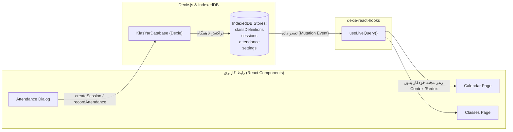

# آموزش IndexedDB از صفر تا `useLiveQuery` (پایگاه‌داده واکنشی و آفلاین در React)

> **سطح:** متوسط تا پیشرفته  
> **پیش‌نیازها:** آشنایی با React (هوک‌ها)، TypeScript و مفهوم پایگاه‌های داده رابطه‌ای  
> **کد مرجع در پروژه:** ماژول پایگاه‌داده کلاس‌یار در پوشه‌ی [`src/db/`](../../src/db/)

---

## فهرست مطالب

1. [مقدمه: چرا دیتابیس کلاینت‌ساید و چرا Dexie.js؟](#۱-مقدمه-چرا-دیتابیس-کلاینتساید-و-چرا-dexiejs)
2. [مسئله در پروژه کلاس‌یار](#۲-مسئله-در-پروژه-کلاسیار)
3. [راهکار گام‌به‌گام با کد واقعی پروژه](#۳-راهکار-گامبهگام-با-کد-واقعی-پروژه)
   - [گام ۱: تعریف تایپ‌ها، کلاس پایگاه‌داده و ایندکس‌گذاری ساختاریافته](#گام-۱-تعریف-تایپها-کلاس-پایگاهداده-و-ایندکسگذاری-ساختاریافته)
   - [گام ۲: اجرای عملیات CRUD و مدیریت خطای لایه‌بندی‌شده](#گام-۲-اجرای-عملیات-crud-و-مدیریت-خطای-لایهبندیشده)
   - [گام ۳: دستیابی به داده‌های واکنشی با `useLiveQuery`](#گام-۳-دستیابی-به-دادههای-واکنشی-با-uselivequery)
   - [گام ۴: کوئری‌های پیشرفته و جوین سه‌گانه در حافظه](#گام-۴-کوئریهای-پیشرفته-و-جوین-سهگانه-در-حافظه)
   - [گام ۵: پشتیبان‌گیری و بازیابی داده‌ها (Backup & Restore)](#گام-۵-پشتیبانگیری-و-بازیابی-دادهها-backup--restore)
4. [لینک به فایل‌های واقعی پروژه](#۴-لینک-به-فایلهای-واقعی-پروژه)
5. [جمع‌بندی و نکات کلیدی](#۵-جمعبندی-و-نکات-کلیدی)

---

## ۱. مقدمه: چرا دیتابیس کلاینت‌ساید و چرا Dexie.js؟

در گذشته، توسعه‌دهندگان وب برای ذخیره‌سازی داده‌ها در مرورگر تنها به `localStorage` یا `sessionStorage` متکی بودند. اما `localStorage` سه محدودیت مهلک دارد:
1. **ظرفیت بسیار محدود:** معمولاً حداکثر ۵ مگابایت حافظه اختصاص می‌یابد.
2. **بلوکه‌کردن رشته اصلی اجرای جاوااسکریپت (Synchronous Blocking):** عملیات خواندن و نوشتن در `localStorage` به صورت همگام است و اگر حجم داده بالا برود، صفحه فریز می‌شود.
3. **فقدان ایندکس و جستجو:** امکان جستجوی سریع روی فیلدها وجود ندارد و باید تمام رشته‌های JSON پارس شوند.

مرورگرهای مدرن برای حل این مشکلات، استانداردی به نام **IndexedDB** را معرفی کردند: یک پایگاه‌داده شیءگرای NoSQL/Transactional با ظرفیت صدها مگابایت و عملیات کاملاً ناهمگام (Asynchronous).

اما کار مستقیم با API خام IndexedDB به شدت پیچیده، سرشار از رویدادهای تو در تو (`onsuccess`, `onerror`)، و مستعد خطاست. **[Dexie.js](https://dexie.org/)** یک انتزاع قدرتمند، سبک و کامپوزپذیر بر روی IndexedDB ارائه می‌دهد که کار با دیتابیس مرورگر را به سادگی و روانی کار با Prisma یا TypeORM تبدیل می‌کند. بسته مکمل **`dexie-react-hooks`** نیز با هوک جادویی `useLiveQuery`، دیتابیس را به یک استور واکنشی (Reactive Store) در کامپوننت‌های React تبدیل می‌نماید.



---

## ۲. مسئله در پروژه کلاس‌یار

کلاس‌یار یک سامانه مدیریت کلاس و جلسات آموزشی با رویکرد **محلی و بدون سرور (Local-First & Offline-First)** است. یعنی:
- معلمان و مدرسان بتوانند اطلاعات ده‌ها کلاس، صدها جلسه آموزشی، صدها دانش‌آموز و وضعیت حضور و غیاب هر جلسه را به طور ایمن در دستگاه خود ذخیره کنند.
- اگر کاربر در یک دیالوگ (مثلاً فرم حضور و غیاب) وضعیت جلسه‌ای را ویرایش کند، همان لحظه تقویم، ماتریس حضور و غیاب و کارت‌های آماری به‌روز شوند؛ **بدون نیاز به نوشتن stateهای تو در تو یا رفرش دستی**.
- جلوگیری از ذخیره داده‌های نامعتبر یا تکراری (مانند ثبت دو حضور برای یک دانش‌آموز در یک جلسه) در پایین‌ترین سطح، یعنی سطح پایگاه‌داده.

---

## ۳. راهکار گام‌به‌گام با کد واقعی پروژه

### گام ۱: تعریف تایپ‌ها، کلاس پایگاه‌داده و ایندکس‌گذاری ساختاریافته

در گام اول، ساختار جداول و ایندکس‌ها را در کلاس مشتق‌شده از `Dexie` مشخص می‌کنیم. به فایل واقعی [`src/db/schema.ts`](../../src/db/schema.ts) نگاه کنید:

```typescript
// بخشی از فایل src/db/schema.ts
import Dexie, { type Table } from "dexie"

export const DB_NAME = "klasyar"
export const DB_VERSION = 1

export interface ClassDefinition {
  id: string
  title: string
  daysOfWeek: DayOfWeek[]
  totalSessions: number
  defaultStart: string
  defaultEnd: string
  color: string
  students: ClassStudent[]
  createdAt: string
  updatedAt: string
}

export interface Session {
  id: string
  definitionId: string
  date: string       // YYYY-MM-DD (شمسی)
  start: string      // HH:MM
  end: string        // HH:MM
  status: SessionStatus
  note: string
  createdAt: string
  updatedAt: string
}

export interface Attendance {
  id: string
  sessionId: string
  studentId: string
  status: AttendanceStatus
}

export class KlasYarDatabase extends Dexie {
  classDefinitions!: Table<ClassDefinition, string>
  sessions!: Table<Session, string>
  attendance!: Table<Attendance, string>
  settings!: Table<Setting, string>

  constructor(name: string = DB_NAME) {
    super(name)

    this.version(DB_VERSION).stores({
      classDefinitions: "id, title, createdAt, updatedAt",
      // ایندکس ترکیبی [definitionId+date] برای جستجوی سریع جلسات بر اساس کلاس و تاریخ
      sessions: "id, definitionId, date, [definitionId+date], status",
      // علامت & نشانگر Unique Index است: مسدودسازی ثبت تکراری حضور یک دانش‌آموز در یک جلسه
      attendance: "id, sessionId, studentId, status, &[sessionId+studentId]",
      settings: "key",
    })
  }
}

export const db = new KlasYarDatabase()
```

#### نکته طلایی در ساختار ایندکس‌های Dexie:
- `id`: کلید اصلی (Primary Key).
- `definitionId`: یک ایندکس ساده برای کوئری‌های `.where("definitionId").equals(...)`.
- `[definitionId+date]`: **ایندکس ترکیبی (Compound Index)**. به موتور پایگاه‌داده اجازه می‌دهد جلسات یک کلاس خاص در یک تاریخ معین را در زمان $O(\log n)$ بیابد.
- `&[sessionId+studentId]`: **ایندکس یکتا (Unique Index)** با پیشوند `&`. مرورگر به صورت سخت‌گیرانه اجازه نخواهد داد دو رکورد با `sessionId` و `studentId` یکسان ذخیره شوند.

---

### گام ۲: اجرای عملیات CRUD و مدیریت خطای لایه‌بندی‌شده

عملیات نوشتن و خواندن درون متدهای تمیز کپسوله شده‌اند. به پیاده‌سازی متد `createClassDefinition` در [`src/db/classDefinitions.ts`](../../src/db/classDefinitions.ts) دقت کنید:

```typescript
// بخشی از فایل src/db/classDefinitions.ts
export async function createClassDefinition(
  input: CreateClassDefinitionInput,
): Promise<ClassDefinition> {
  const title = input.title.trim()
  if (!title) {
    throw new DatabaseError("validation", "عنوان کلاس الزامی است.")
  }

  const now = nowIso()
  const record: ClassDefinition = {
    id: newId(),
    title,
    daysOfWeek: [...input.daysOfWeek].sort((a, b) => a - b),
    totalSessions: input.totalSessions,
    defaultStart: normalizeTime(input.defaultStart),
    defaultEnd: normalizeTime(input.defaultEnd),
    color: input.color,
    students: sanitizeStudents(input.students),
    createdAt: now,
    updatedAt: now,
  }

  try {
    await db.classDefinitions.add(record)
    return record
  } catch (error) {
    throw normalizeDatabaseError(error)
  }
}
```

تمام خطاهای احتمالی از طریق `normalizeDatabaseError` در [`src/db/errors.ts`](../../src/db/errors.ts) رهگیری شده و به خطاهای استاندارد و انسان‌خوان با پیام‌های روان فارسی تبدیل می‌شوند.

---

### گام ۳: دستیابی به داده‌های واکنشی با `useLiveQuery`

چطور بدون استفاده از Redux، Zustand یا بازخوانی دستی با `useEffect`، داده‌های پایگاه‌داده به صورت زنده در کامپوننت‌های React منعکس شوند؟

کتابخانه `dexie-react-hooks` قابلیتی به نام `useLiveQuery` ارائه می‌دهد که به صورت خودکار رخدادهای تغییر جداول را رصد می‌کند. هوک‌های اختصاصی پروژه در فایل [`src/db/hooks.ts`](../../src/db/hooks.ts) تعریف شده‌اند:

```typescript
// بخشی از فایل src/db/hooks.ts
import { useLiveQuery } from "dexie-react-hooks"
import { getAllClassDefinitions } from "./classDefinitions"
import { getSessionsByDateRange } from "./sessions"

/**
 * دریافت لیست تمام کلاس‌ها به صورت واکنشی.
 * تا زمانی که اولین پاسخ از دیتابیس آماده شود خروجی undefined است (وضعیت در حال بارگذاری).
 */
export function useClassDefinitions(): ClassDefinition[] | undefined {
  return useLiveQuery(() => getAllClassDefinitions(), [])
}

/**
 * دریافت جلسات یک بازه زمانی خاص با آرگومان‌های وابسته (Dependency Array).
 */
export function useSessionsByDateRange(
  from: string | null | undefined,
  to: string | null | undefined,
): Session[] | undefined {
  return useLiveQuery(
    () => (from && to ? getSessionsByDateRange(from, to) : Promise.resolve([])),
    [from, to],
  )
}
```

#### نحوه مصرف هوک در کامپوننت React:

```tsx
// نمونه مصرف در src/pages/calendar-page.tsx
export default function CalendarPage() {
  const definitions = useClassDefinitions()
  const sessionsInView = useSessionsByDateRange(viewBounds.from, viewBounds.to)

  if (definitions === undefined || sessionsInView === undefined) {
    return <LoadingSkeleton />
  }

  return (
    <div>
      <h1>تعداد جلسات بازه: {sessionsInView.length}</h1>
      {/* رندر تقویم و رویدادها */}
    </div>
  )
}
```

**مزیت انقلابی:** اگر کاربر در یک مودال، جلسه‌ای را حذف کند یا ساعت آن را تغییر دهد، کامپوننت تقویم بدون این که حتی بداند چه کسی داده را تغییر داده، با دریافت پاسخ جدید از IndexedDB فورا و خودکار Re-render می‌شود!

---

### گام ۴: کوئری‌های پیشرفته و جوین سه‌گانه در حافظه

پایگاه داده IndexedDB یک دیتابیس NoSQL است و دستور SQL `JOIN` در آن وجود ندارد. اما با Dexie و `useLiveQuery` می‌توان جوین‌های ترکیبی با کارایی بالا ساخت. به هوک `useClassMonthlyAttendance` در [`src/db/hooks.ts`](../../src/db/hooks.ts) دقت کنید:

```typescript
// هوک چندمنظوره ماتریس حضور و غیاب ماهانه
export function useClassMonthlyAttendance(
  definitionId: string | null | undefined,
  year: number,
  month: number,
): ClassMonthlyAttendanceResult | null | undefined {
  const monthKey = `${year}-${String(month).padStart(2, "0")}`

  return useLiveQuery(async () => {
    if (!definitionId) return null

    // ۱. دریافت مشخصات کلاس
    const definition = await db.classDefinitions.get(definitionId)
    if (!definition) return null

    // ۲. دریافت تمام جلسات کلاس با ایندکس definitionId
    const sessions = await db.sessions
      .where("definitionId")
      .equals(definitionId)
      .toArray()

    // ۳. فیلتر جلسات ماه و مرتب‌سازی بر اساس تاریخ و ساعت
    const monthSessions = sessions
      .filter((session) => session.date.startsWith(`${monthKey}-`))
      .sort(
        (a, b) =>
          a.date.localeCompare(b.date) || a.start.localeCompare(b.start),
      )

    // ۴. دریافت دسته‌جمعی رکوردهای حضور و غیاب با عملگر anyOf
    const sessionIds = monthSessions.map((session) => session.id)
    const records =
      sessionIds.length > 0
        ? await db.attendance.where("sessionId").anyOf(sessionIds).toArray()
        : []

    return {
      definition,
      sessions: monthSessions,
      attendance: records,
    }
  }, [definitionId, monthKey])
}
```

با این تابع، اطلاعات سه جدول به صورت واکنشی تلفیق شده و هرگونه تغییر در کلاس، جلسات یا حضور و غیاب، کل جدول ماتریس را به روز نگاه می‌دارد.

---

### گام ۵: پشتیبان‌گیری و بازیابی داده‌ها (Backup & Restore)

یکی از الزامات نرم‌افزارهای آفلاین، قابلیت استخراج دیتابیس در قالب یک فایل برای نگهداری امن است. کلاس‌یار از پکیج `dexie-export-import` در [`src/lib/backup.ts`](../../src/lib/backup.ts) استفاده می‌کند:

```typescript
// فایل src/lib/backup.ts
import { exportDB, importInto } from "dexie-export-import"
import { db } from "@/db/schema"

export async function exportDatabaseToJson(): Promise<Blob> {
  return await exportDB(db, {
    prettyJson: true,
  })
}

export async function restoreDatabaseFromJson(file: File): Promise<void> {
  await importInto(db, file, {
    clearTablesBeforeImport: true,
    overwriteValues: true,
  })
}
```

این متدها کل جداول، ایندکس‌ها و مقادیر را به صورت یک فایل استاندارد JSON تبدیل یا بازگردانی می‌کنند.

---

## ۴. لینک به فایل‌های واقعی پروژه

برای مشاهده کدهای کامل و الگوهای پیشرفته، فایل‌های زیر را بررسی کنید:

- اسکیمای اصلی و ایندکس‌ها: [`src/db/schema.ts`](../../src/db/schema.ts)
- هوک‌های واکنشی لایو: [`src/db/hooks.ts`](../../src/db/hooks.ts)
- عملیات جلسات و فیلترهای تاریخی: [`src/db/sessions.ts`](../../src/db/sessions.ts)
- عملیات کلاس‌ها و اعتبارسنجی: [`src/db/classDefinitions.ts`](../../src/db/classDefinitions.ts)
- رکوردهای حضور و غیاب و ایندکس مرکب: [`src/db/attendance.ts`](../../src/db/attendance.ts)
- یکپارچه‌سازی و نرمال‌سازی خطاهای پایگاه داده: [`src/db/errors.ts`](../../src/db/errors.ts)
- ماژول پشتیبان‌گیری و درون‌ریزی: [`src/lib/backup.ts`](../../src/lib/backup.ts)

---

## ۵. جمع‌بندی و نکات کلیدی

1. **انتقال از LocalStorage به IndexedDB:** برای هر برنامه‌ای که داده‌های آن بیش از چند کلید ساده است، IndexedDB تنها راهکار حرفه‌ای، غیرمسدودکننده و با ظرفیت بالاست.
2. **سادگی شگفت‌انگیز Dexie.js:** با Dexie دیگر نیازی به هندل کردن دستی تراکنش‌های پیچیده IndexedDB ندارید و از Type-Safety کامل در TypeScript بهره‌مند می‌شوید.
3. **معماری واکنشی با `useLiveQuery`:** نیاز به Redux یا سیستم‌های پیچیده انتشار/اشتراک (Pub/Sub) برای داده‌های دیتابیس را برطرف کرده و عملکرد برنامه را به صورت چشم‌گیری روان و ساده می‌سازد.
4. **ایندکس‌گذاری هوشمندانه:** تعیین ایندکس‌های ترکیبی مانند `[definitionId+date]` و ایندکس یکتای `&[sessionId+studentId]` تضمین‌کننده سرعت بالا و یکپارچگی داده‌هاست.
