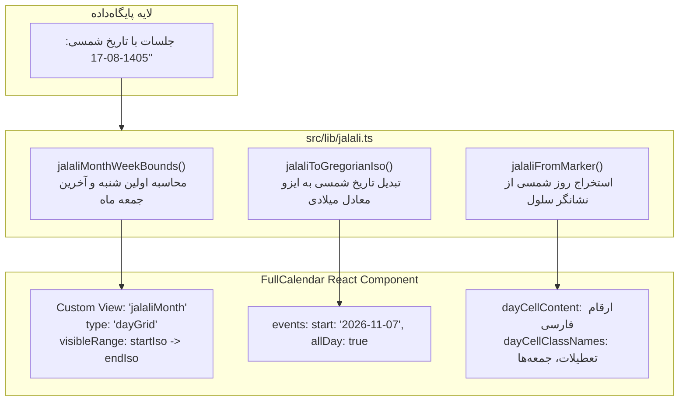

# چطور FullCalendar را با تقویم شمسی، جهت RTL و شروع هفته از شنبه راه بیندازیم؟

> **سطح:** پیشرفته  
> **پیش‌نیازها:** آشنایی با کامپوننت‌های React، کتابخانه FullCalendar و محاسبات گاه‌شماری  
> **کد مرجع در پروژه:** ماژول گاه‌شماری [`src/lib/jalali.ts`](../../src/lib/jalali.ts) و صفحه تقویم [`src/pages/calendar-page.tsx`](../../src/pages/calendar-page.tsx)

---

## فهرست مطالب

1. [مقدمه: چالش بزرگ تقویم شمسی در وب](#۱-مقدمه-چالش-بزرگ-تقویم-شمسی-در-وب)
2. [مسئله در FullCalendar: چرا راه‌حل‌های عادی شکست می‌خورند؟](#۲-مسئله-در-fullcalendar-چرا-راهحلهای-عادی-شکست-میخورند)
3. [راهکار گام‌به‌گام با کد واقعی پروژه](#۳-راهکار-گامبهگام-با-کد-واقعی-پروژه)
   - [گام ۱: ریاضیات تقویم جلالی با کتابخانه `jalaali-js`](#گام-۱-ریاضیات-تقویم-جلالی-با-کتابخانه-jalaali-js)
   - [گام ۲: محاسبه مرزهای هفتگی ماه شمسی (`jalaliMonthWeekBounds`)](#گام-۲-محاسبه-مرزهای-هفتگی-ماه-شمسی-jalalimonthweekbounds)
   - [گام ۳: تعریف نمای سفارشی (Custom View) با `visibleRange` پویا](#گام-۳-تعریف-نمای-سفارشی-custom-view-با-visiblerange-پویا)
   - [گام ۴: پیکربندی RTL، زبان فارسی و شروع هفته از شنبه](#گام-۴-پیکربندی-rtl-زبان-فارسی-و-شروع-هفته-از-شنبه)
   - [گام ۵: نگاشت رویدادها و تبدیل تاریخ به ایزو میلادی برای موتور چیدمان](#گام-۵-نگاشت-رویدادها-و-تبدیل-تاریخ-به-ایزو-میلادی-برای-موتور-چیدمان)
   - [گام ۶: سفارشی‌سازی محتوای سلول‌ها، ارقام فارسی و تعطیلات رسمی](#گام-۶-سفارشیسازی-محتوای-سلولها-ارقام-فارسی-و-تعطیلات-رسمی)
   - [گام ۷: استایل‌دهی و رفع خطاهای چیدمان با CSS](#گام-۷-استایلدهی-و-رفع-خطاهای-چیدمان-با-css)
4. [لینک به فایل‌های واقعی پروژه](#۴-لینک-به-فایلهای-واقعی-پروژه)
5. [جمع‌بندی و نکات کلیدی](#۵-جمعبندی-و-نکات-کلیدی)

---

## ۱. مقدمه: چالش بزرگ تقویم شمسی در وب

تقویم یکی از پیچیده‌ترین بخش‌های هر سیستم آموزشی یا برنامه‌ریزی است. [FullCalendar](https://fullcalendar.io/) استاندارد طلایی و محبوب‌ترین کتابخانه تقویم در دنیای جاوااسکریپت و ری‌اکت به شمار می‌رود: دارای موتور چیدمان منعطف، تعاملات ماوس و لمس، کارایی استثنایی در رندر هزاران رویداد و دسترسی‌پذیری بالا است.

با این حال، مانند ۹۹٪ کتابخانه‌های بین‌المللی، FullCalendar به صورت درونی کاملاً بر مبنای **گاه‌شماری میلادی (Gregorian)** و شیء نیتیو `Date` طراحی شده است. تطبیق چنین موتوری با گاه‌شماری هجری شمسی (جلالی) که طول ماه‌های متفاوتی دارد (۶ ماه ۳۱ روزه، ۵ ماه ۳۰ روزه، و ۱ ماه ۲۹ یا ۳۰ روزه) و هفته آن از شنبه آغاز می‌شود، یکی از بزرگ‌ترین چالش‌های مهندسی فرانت‌اند در زبان فارسی است.



---

## ۲. مسئله در FullCalendar: چرا راه‌حل‌های عادی شکست می‌خورند؟

اگر صرفاً از پراپ `locale="fa"` در FullCalendar استفاده کنید، با مشکلات زیر مواجه خواهید شد:
1. **ماه میلادی رندر می‌شود:** نمای پیش‌فرض `initialView="dayGridMonth"` ماه‌ها را از ۱ ژانویه تا ۳۱ ژانویه یا ۱ نوامبر تا ۳۰ نوامبر می‌سازد؛ یعنی در ماه آبان شمسی، نیمی از صفحه روزهای آبان و نیم دیگر آذر یا مهر خواهد بود!
2. **روز اول هفته نادرست است:** در حالت پیش‌فرض، روز اول تقویم یکشنبه (`firstDay: 0`) یا دوشنبه (`firstDay: 1`) است، در حالی که در ایران هفته باید از **شنبه** آغاز شود.
3. **پرش زمانی و خطای ۱ روز جابه‌جایی (Timezone Off-by-one):** تبدیل‌های محلی تاریخ به اشیاء `Date` مرورگر به دلیل اختلاف ساعت و Daylight Saving Time می‌توانند تاریخ را یک روز جلو یا عقب بیندازند.

---

## ۳. راهکار گام‌به‌گام با کد واقعی پروژه

کلاس‌یار این چالش را با یک معماری تمیز چندمرحله‌ای حل کرده است:

### گام ۱: ریاضیات تقویم جلالی با کتابخانه `jalaali-js`

در ماژول [`src/lib/jalali.ts`](../../src/lib/jalali.ts) از هسته محاسباتی دقیق `jalaali-js` بهره می‌بریم. تایپ‌های اصلی به شکل زیر تعریف شده‌اند:

```typescript
// بخشی از فایل src/lib/jalali.ts
import {
  jalaaliMonthLength,
  isValidJalaaliDate,
  jalaaliToDateObject,
  toGregorian,
  toJalaali,
} from "jalaali-js"

export interface JalaliDate {
  year: number
  month: number
  day: number
}

/** شنبه = ۰ … جمعه = ۶؛ هم‌راستا با DayOfWeek در دیتابیس */
export const JALALI_WEEKDAY_NAMES = [
  "شنبه",
  "یکشنبه",
  "دوشنبه",
  "سه‌شنبه",
  "چهارشنبه",
  "پنجشنبه",
  "جمعه",
] as const

/** تبدیل تاریخ میلادی به تاریخ دقیق شمسی بدون پرش تایم‌زونی */
export function jalaliFromDate(date: Date): JalaliDate {
  const j = toJalaali(date.getFullYear(), date.getMonth() + 1, date.getDate())
  return { year: j.jy, month: j.jm, day: j.jd }
}
```

---

### گام ۲: محاسبه مرزهای هفتگی ماه شمسی (`jalaliMonthWeekBounds`)

برای این که جدول ماهانه FullCalendar کامل باشد، نمی‌توانیم فقط از روز ۱ تا ۳۰ ماه را به آن بدهیم؛ بلکه باید اولین شنبه‌ای که قبل یا همزمان با اول ماه است را به عنوان روز آغازین، و آخرین جمعه‌ای که بعد یا همزمان با پایان ماه است را به عنوان روز پایانی به دست آوریم. این تابع در [`src/lib/jalali.ts`](../../src/lib/jalali.ts) پیاده‌سازی شده است:

```typescript
// محاسبه مرزهای کامل هفته‌های یک ماه شمسی برای شبکه تقویم
export function jalaliMonthWeekBounds(
  year: number,
  month: number,
): {
  firstDayDate: JalaliDate
  lastDayDate: JalaliDate
  startIso: string          // اولین شنبه با فرمت YYYY-MM-DD میلادی
  endExclusiveIso: string   // روز بعد از آخرین جمعه با فرمت YYYY-MM-DD میلادی
  totalDays: number
} {
  const daysInMonth = jalaaliMonthLength(year, month)
  const firstDayOfMonth: JalaliDate = { year, month, day: 1 }
  const lastDayOfMonth: JalaliDate = { year, month, day: daysInMonth }

  // روز هفته اول ماه (۰ = شنبه ... ۶ = جمعه)
  const firstWeekday = jalaliDayOfWeek(firstDayOfMonth)
  // روز هفته آخر ماه
  const lastWeekday = jalaliDayOfWeek(lastDayOfMonth)

  // عقب رفتن تا شنبه
  const gridStart = shiftJalaliDay(firstDayOfMonth, -firstWeekday)
  // جلو رفتن تا جمعه
  const daysUntilFriday = (6 - lastWeekday + 7) % 7
  const gridEndInclusive = shiftJalaliDay(lastDayOfMonth, daysUntilFriday)
  // FullCalendar بازه پایانی را Exclusive در نظر می‌گیرد (روز بعد)
  const gridEndExclusive = shiftJalaliDay(gridEndInclusive, 1)

  return {
    firstDayDate: firstDayOfMonth,
    lastDayDate: lastDayOfMonth,
    startIso: jalaliToGregorianIso(gridStart),
    endExclusiveIso: jalaliToGregorianIso(gridEndExclusive),
    totalDays: (daysUntilFriday + daysInMonth + firstWeekday),
  }
}
```

---

### گام ۳: تعریف نمای سفارشی (Custom View) با `visibleRange` پویا

در FullCalendar نمای استاندارد `dayGridMonth` همیشه بازه میلادی دارد و پراپ `visibleRange` را نادیده می‌گیرد. راهکار هوشمندانه کلاس‌یار، تعریف یک **Custom View** با نام `jalaliMonth` است:

```typescript
// در src/pages/calendar-page.tsx
const viewBounds = useMemo(
  () => jalaliMonthWeekBounds(month.year, month.month),
  [month.year, month.month],
)

const visibleRange = useMemo(
  () => ({
    start: viewBounds.startIso,
    end: viewBounds.endExclusiveIso,
  }),
  [viewBounds],
)

// تعریف Custom View مبتنی بر dayGrid اما با مرزهای دقیق ماه شمسی
const calendarViews = useMemo(
  () => ({
    jalaliMonth: {
      type: "dayGrid",
      visibleRange: () => visibleRange,
    },
  }),
  [visibleRange],
)
```

---

### گام ۴: پیکربندی RTL، زبان فارسی و شروع هفته از شنبه

برای استقرار جهت تقویم و شماره‌گذاری روزها، پراپ‌های کامپوننت `FullCalendar` در [`src/pages/calendar-page.tsx`](../../src/pages/calendar-page.tsx) به شکل زیر تنظیم شده‌اند:

```tsx
<FullCalendar
  key={monthKey} // کلید برای رندر مجدد بدون پرش در زمان تغییر ماه
  plugins={[dayGridPlugin, interactionPlugin]}
  initialView="jalaliMonth"
  views={calendarViews}
  initialDate={viewBounds.startIso}
  locale="fa"
  locales={[faLocale]}
  direction="rtl"
  firstDay={6} // در سیستم FullCalendar عدد 6 یعنی شنبه (شنبه=۶، یکشنبه=۰)
  headerToolbar={false} // هدر پیش‌فرض حذف و با کنترل‌های مدرن جایگزین شده
  footerToolbar={false}
  height="auto"
  fixedWeekCount={false}
  showNonCurrentDates={true}
  events={events}
  eventContent={renderEventContent}
  dayCellContent={(info) => toPersianDigits(jalaliFromMarker(info.date).day)}
  dayCellClassNames={dayCellClassNames}
/>
```

> **نکته بسیار مهم:** در قرارداد استاندارد بین‌المللی جاوااسکریپت و FullCalendar، یکشنبه عدد ۰ است. بنابراین روز شنبه برابر با **عدد ۶** است. تنظیم `firstDay={6}` باعث می‌شود ستون اول سمت راست در حالت RTL به روز شنبه اختصاص یابد.

---

### گام ۵: نگاشت رویدادها و تبدیل تاریخ به ایزو میلادی برای موتور چیدمان

جلسات در دیتابیس با تاریخ شمسی مثل `"1405-08-17"` ذخیره شده‌اند. برای اینکه FullCalendar بتواند رویداد را در سلول صحیح قرار دهد، تاریخ را به صورت میلادی تبدیل کرده و آبجکت‌های واقعی سشن را درون `extendedProps` ذخیره می‌کنیم:

```typescript
// بخشی از src/pages/calendar-page.tsx
const events = useMemo<EventInput[]>(() => {
  return [...(sessionsInView ?? [])]
    .sort((a, b) => a.date.localeCompare(b.date) || a.start.localeCompare(b.start))
    .flatMap((session) => {
      const definition = definitionById.get(session.definitionId)
      if (!definition) return []

      return [
        {
          id: session.id,
          title: definition.title,
          // تبدیل تاریخ شمسی جلسه به میلادی ایزو معتبر برای FullCalendar
          start: jalaliToGregorianIso(parseJalaliDate(session.date)),
          allDay: true,
          // نگهداری داده‌های اصلی برای کامپوننت رندر سفارشی
          extendedProps: { session, definition },
        } satisfies EventInput,
      ]
    })
}, [sessionsInView, definitionById])
```

---

### گام ۶: سفارشی‌سازی محتوای سلول‌ها، ارقام فارسی و تعطیلات رسمی

برای اینکه داخل سلول‌ها به جای اعداد انگلیسی روز میلادی، روز شمسی با فونت فارسی نمایش یابد:

```typescript
function jalaliFromMarker(marker: number | Date): JalaliDate {
  return jalaliFromDate(new Date(marker))
}

// در پراپ dayCellContent:
dayCellContent={(info) => toPersianDigits(jalaliFromMarker(info.date).day)}

// در پراپ dayCellClassNames برای اعمال استایل‌های اختصاصی:
dayCellClassNames={(info) => {
  const date = jalaliFromMarker(info.date)
  const dateIso = jalaliDateToString(date)
  const classes: string[] = []

  if (date.year !== month.year || date.month !== month.month) {
    classes.push("kl-other-month") // روزهای ماه قبل یا بعد
  }
  if (isFriday(date)) classes.push("kl-weekend") // جمعه‌ها
  if (getOfficialHoliday(date)) classes.push("kl-holiday") // تعطیلات تقویم رسمی
  if (selectedDate === dateIso) classes.push("kl-selected") // روز انتخاب‌شده
  return classes
}}
```

و برای نمایش چیپ‌های زیبا با رنگ هر کلاس، از تابع `renderEventContent` و کامپوننت [`SessionChip`](../../src/components/calendar/session-chip.tsx) بهره می‌بریم:

```tsx
const renderEventContent = useCallback((arg: EventContentArg) => {
  const session = arg.event.extendedProps.session as Session | undefined
  const definition = arg.event.extendedProps.definition as ClassDefinition | undefined
  if (!session || !definition) return true

  return <SessionChip session={session} definition={definition} />
}, [])
```

---

### گام ۷: استایل‌دهی و رفع خطاهای چیدمان با CSS

کلاس‌های سفارشی تعریف‌شده در [`src/components/calendar/calendar.css`](../../src/components/calendar/calendar.css) ظاهر خام FullCalendar را کاملاً با تم مدرن و مینیمال هماهنگ می‌کنند:

```css
/* بخشی از src/components/calendar/calendar.css */
.klasyar-calendar .fc-theme-standard td,
.klasyar-calendar .fc-theme-standard th {
  border-color: hsl(var(--border) / 0.6);
}

/* روزهای جمعه */
.klasyar-calendar .kl-weekend {
  background-color: hsl(var(--muted) / 0.3);
}

/* روزهای ماه قبل یا بعد */
.klasyar-calendar .kl-other-month {
  opacity: 0.35;
}

/* روزهای تعطیل رسمی تقویم ایران */
.klasyar-calendar .kl-holiday .fc-daygrid-day-top {
  color: hsl(var(--destructive));
  font-weight: 700;
}

/* استایل روز انتخابی کاربر */
.klasyar-calendar .kl-selected {
  outline: 2px solid hsl(var(--primary));
  outline-offset: -2px;
}
```

---

## ۴. لینک به فایل‌های واقعی پروژه

- موتور محاسباتی تقویم شمسی و تبدیل میلادی-جلالی: [`src/lib/jalali.ts`](../../src/lib/jalali.ts)
- پیاده‌سازی صفحه تقویم و پیکربندی FullCalendar: [`src/pages/calendar-page.tsx`](../../src/pages/calendar-page.tsx)
- استایل‌های تقویم و هماهنگی با تم روشن و تاریک: [`src/components/calendar/calendar.css`](../../src/components/calendar/calendar.css)
- مؤلفه رندر اختصاصی کارت جلسه در سلول تقویم: [`src/components/calendar/session-chip.tsx`](../../src/components/calendar/session-chip.tsx)
- پنل کناری نمایش جزئیات جلسات روز انتخاب‌شده: [`src/components/calendar/session-day-panel.tsx`](../../src/components/calendar/session-day-panel.tsx)

---

## ۵. جمع‌بندی و نکات کلیدی

1. **جایگزینی `dayGridMonth` با Custom View:** کلید اصلی راه اندازی تقویم شمسی در FullCalendar، تعریف نمای سفارشی با `visibleRange` پویا است که با هفته‌های ماه شمسی همگام باشد.
2. **پیکربندی شنبه با `firstDay={6}`:** ترتیب روزهای هفته در تقویم فارسی از شنبه شروع می‌شود و در حالت RTL سمت راست‌ترین ستون خواهد بود.
3. **تفکیک تمیز لایه‌ها:** داده‌ها در دیتابیس با فرمت جلالی باقی می‌مانند؛ لایه میانی تبدیل میلادی را صرفاً برای مکان‌یابی المان‌ها به کار می‌گیرد؛ و محتوای سلول‌ها مجدداً با فرمت جلالی و ارقام فارسی رندر می‌شود.
4. **عملکرد فوق‌العاده:** این رویکرد هیچ پکیج تقویم غیررسمی یا سنگین اضافه نمی‌کند و از تمام مزایای FullCalendar اصلی با بالاترین سرعت بهره می‌برد.
