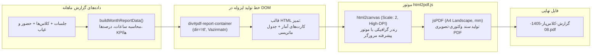

# چالش تولید PDF فارسی در وب کلاینت‌ساید و راه‌حل کامل و پایدار

> **سطح:** متوسط  
> **پیش‌نیازها:** آشنایی با DOM، مفاهیم چاپ وب (Print Media) و کتابخانه‌های خروجی فایل  
> **کد مرجع در پروژه:** ماژول خروجی PDF در [`src/lib/reports/export-pdf.ts`](../../src/lib/reports/export-pdf.ts) و سازنده داده‌های گزارش [`src/lib/reports/data-builder.ts`](../../src/lib/reports/data-builder.ts)

---

## فهرست مطالب

1. [مقدمه: چرا تولید PDF در زبان فارسی یک کابوس بود؟](#۱-مقدمه-چرا-تولید-pdf-در-زبان-فارسی-یک-کابوس-بود)
2. [مسئله و چالش‌های فنی متون فارسی در کلاینت](#۲-مسئله-و-چالشهای-فنی-متون-فارسی-در-کلاینت)
3. [معماری برگزیده: DOM-to-Canvas-to-PDF با `html2pdf.js`](#۳-معماری-برگزیده-dom-to-canvas-to-pdf-با-html2pdfjs)
4. [راهکار گام‌به‌گام با کد واقعی پروژه](#۴-راهکار-گامبهگام-با-کد-واقعی-پروژه)
   - [گام ۱: آماده‌سازی داده‌های ساختاریافته (Data Builder)](#گام-۱-آمادهسازی-دادههای-ساختاریافته-data-builder)
   - [گام ۲: ساخت کانتینر موقت ایزوله (Off-Screen DOM Container)](#گام-۲-ساخت-کانتینر-موقت-ایزوله-off-screen-dom-container)
   - [گام ۳: تعبیه فونت وزیرمتن (Vazirmatn) و جهت‌گیری راست‌به‌چپ (RTL)](#گام-۳-تعبیه-فونت-وزیرمتن-vazirmatn-و-جهتگیری-راستبهچپ-rtl)
   - [گام ۴: تبدیل ارقام به فارسی با `toPersianDigits`](#گام-۴-تبدیل-ارقام-به-فارسی-با-topersiandigits)
   - [گام ۵: تنظیمات کیفیت بالا (Retina Scale: 2) و ابعاد استاندارد A4 Landscape](#گام-۵-تنظیمات-کیفیت-بالا-retina-scale-2-و-ابعاد-استاندارد-a4-landscape)
   - [گام ۶: پاکسازی حافظه در بلوک `finally` برای جلوگیری از Memory Leak](#گام-۶-پاکسازی-حافظه-در-بلوک-finally-برای-جلوگیری-از-memory-leak)
5. [لینک به فایل‌های واقعی پروژه](#۵-لینک-به-فایلهای-واقعی-پروژه)
6. [جمع‌بندی و نکات کلیدی](#۶-جمعبندی-و-نکات-کلیدی)

---

## ۱. مقدمه: چرا تولید PDF در زبان فارسی یک کابوس بود؟

در دنیای وب بین‌المللی، تولید اسناد PDF معمولاً با کتابخانه‌های متنی مثل **jsPDF** یا **pdfmake** انجام می‌شود. اما کافی است یک بار تلاش کنید یک پاراگراف متن فارسی را با jsPDF به طور مستقیم رندر کنید: با متنی وارونه، حروفی جدا از هم و علامت‌های نگارشی به هم ریخته مواجه خواهید شد!

این موضوع زمانی بحرانی‌تر می‌شود که بدانیم **کلاس‌یار یک سامانه آفلاین و بدون سرور (Local-First)** است؛ یعنی امکان فرستادن HTML به یک سرور Node.js مجهز به Puppeteer یا Headless Chrome برای رندر PDF وجود ندارد و همه‌چیز باید به صورت ۱۰۰٪ امن، بدون هزینه و در مرورگر کاربر تولید شود.



---

## ۲. مسئله و چالش‌های فنی متون فارسی در کلاینت

چهار چالش اصلی در رندر PDF فارسی عبارتند از:
1. **عدم اتصال حروف چسبان (Complex Text Reshaping):** زبان فارسی برخلاف خط لاتین، دارای حروف پیوسته است که شکل گلیف آن‌ها با توجه به موقعیت در کلمه (آغاز، میانه، پایان، تنها) تغییر می‌کند. موتورهای PDF سنتی از موتور HarfBuzz یا OpenType Shaper مرورگر بی‌بهره‌اند.
2. **الگوریتم دوجهته (Bi-directional / Bidi):** هنگامی که متن فارسی با اعداد یا کلمات انگلیسی ترکیب می‌شود (مانند `"ساعت 16:30"` یا `"کلاس React"`), ترتیب خواندن متون بدون الگوریتم Bidi معکوس می‌شود.
3. **نبود فونت‌های فارسی در استاندارد Core-14 PDF:** داکیومنت‌های PDF استاندارد تنها ۱۴ فونت پیش‌فرض (مانند Times، Courier و Helvetica) دارند که هیچ‌کدام حروف الفبای فارسی را پوشش نمی‌دهند.
4. **تاری متن در تبدیل‌های تصویری:** اگر برای دور زدن این مشکل، صفحه را اسکرین‌شات بگیرید و در PDF بگذارید، کیفیت متن در هنگام چاپ به شدت تار و بی‌کیفیت خواهد شد.

---

## ۳. معماری برگزیده: DOM-to-Canvas-to-PDF با `html2pdf.js`

بهترین و پایدارترین راه حل در فرانت‌اند مدرن، استفاده از رویکرد **DOM-to-Canvas-to-PDF** به کمک کتابخانه `html2pdf.js` است:
- مرورگر کاربر (کروم، فایرفاکس، سافاری، اج) از پیشرفته‌ترین موتور رندرینگ متون و تایپوگرافی در دنیا استفاده می‌کند و تمام ظرافت‌های خط فارسی، اتصال حروف و راست‌به‌چپ را بی‌نقص پردازش می‌کند.
- ما یک قالب HTML با کلاس‌های دقیق می‌سازیم، مرورگر آن را رندر می‌کند، سپس `html2canvas` آن را با مقیاس شبکیه چشم (Retina Scale = 2) به کانواس تبدیل کرده و در نهایت `jsPDF` آن را در قالب یک سند استاندارد A4 چاپ می‌نماید.

---

## ۴. راهکار گام‌به‌گام با کد واقعی پروژه

### گام ۱: آماده‌سازی داده‌های ساختاریافته (Data Builder)

پیش از چاپ، داده‌ها در تابع `buildMonthReportData` در [`src/lib/reports/data-builder.ts`](../../src/lib/reports/data-builder.ts) به یک مدل داده پاکیزه و آماده مصرف تبدیل می‌شوند:

```typescript
// بخشی از src/lib/reports/data-builder.ts
export function buildMonthReportData(
  year: number,
  month: number,
  sessions: Session[],
  definitions: ClassDefinition[],
  attendance: Attendance[],
): MonthReportData {
  // ۱. فیلتر جلسات ماه
  // ۲. محاسبه مجموع ساعات جلسات
  // ۳. محاسبه درصد حضور و غیاب با calculateAttendancePercentage
  // ۴. استخراج شاخص‌های کلیدی (KPIs)
  return {
    monthKey: `${year}-${pad2(month)}`,
    monthTitle: formatJalaliMonthTitle(year, month),
    summary: { totalSessions, heldSessions, totalHours, overallAttendanceRate },
    sessions: sessionItems,
    classSummaries,
  }
}
```

---

### گام ۲: ساخت کانتینر موقت ایزوله (Off-Screen DOM Container)

برای اینکه خروجی PDF به اندازه پنجره کاربر، اسکرول‌بارها یا تم جاری (مثلاً تم دارک) وابسته نباشد، یک المان جدید در حافظه می‌سازیم و آن را موقتاً به صفحه متصل می‌کنیم. به پیاده‌سازی [`src/lib/reports/export-pdf.ts`](../../src/lib/reports/export-pdf.ts) دقت کنید:

```typescript
// فایل src/lib/reports/export-pdf.ts
export async function exportToPdf(report: MonthReportData): Promise<void> {
  const container = document.createElement("div")
  container.id = "pdf-report-container"
  container.setAttribute("dir", "rtl")

  const todayStr = formatJalaliFullDate(todayJalali())

  // تزریق HTML ساختاریافته و استایل‌های ایزوله چاپی
  container.innerHTML = `...`
```

---

### گام ۳: تعبیه فونت وزیرمتن (Vazirmatn) و جهت‌گیری راست‌به‌چپ (RTL)

درون استایل تزریق‌شده به کانتینر، فونت استاندارد ملی و محبوب **وزیرمتن** به صورت محلی معرفی شده و چیدمان سند به صورت سخت‌گیرانه روی `direction: rtl` و `text-align: right` تنظیم می‌شود:

```html
<style>
  @font-face {
    font-family: 'Vazirmatn';
    src: url('/fonts/Vazirmatn-Variable.woff2') format('woff2');
    font-weight: 100 900;
    font-style: normal;
  }
  #pdf-report-container {
    font-family: 'Vazirmatn', -apple-system, BlinkMacSystemFont, 'Segoe UI', Roboto, sans-serif;
    direction: rtl;
    text-align: right;
    background: #ffffff;
    color: #1e293b;
    padding: 24px;
    box-sizing: border-box;
  }
  .pdf-header {
    display: flex;
    justify-content: space-between;
    align-items: flex-start;
    border-bottom: 2px solid #0d9488;
    padding-bottom: 12px;
    margin-bottom: 16px;
  }
  .pdf-table {
    width: 100%;
    border-collapse: collapse;
    font-size: 10.5px;
    margin-bottom: 16px;
  }
  .pdf-table th {
    background: #f1f5f9;
    color: #334155;
    font-weight: 700;
    border: 1px solid #cbd5e1;
    padding: 6px 8px;
    text-align: center;
  }
  .pdf-table td {
    border: 1px solid #e2e8f0;
    padding: 6px 8px;
    text-align: center;
  }
</style>
```

---

### گام ۴: تبدیل ارقام به فارسی با `toPersianDigits`

اسناد رسمی آموزشی نباید ارقام انگلیسی (1, 2, 3) در کنار متن فارسی داشته باشند. کلاس‌یار تمام مقادیر عددی، ساعت‌ها، مدت‌زمان‌ها و درصدها را با تابع کمکی `toPersianDigits` قالب‌بندی می‌کند:

```typescript
// نمونه رندر سطرهای جدول در قالب PDF
${report.sessions.map((item, index) => `
  <tr>
    <td>${toPersianDigits(index + 1)}</td>
    <td class="text-start" style="font-weight: 700;">${item.classTitle}</td>
    <td>${item.dateStr}</td>
    <td>${item.weekday}</td>
    <td dir="ltr">${toPersianDigits(item.start)} - ${toPersianDigits(item.end)}</td>
    <td>${toPersianDigits(item.durationMinutes)} دقیقه</td>
    <td><span class="status-badge ${statusClass}">${item.statusLabel}</span></td>
    <td>${item.attendance.rate !== null ? `${toPersianDigits(item.attendance.rate)}٪` : "—"}</td>
    <td class="text-start" style="color: #64748b;">${item.note || "—"}</td>
  </tr>
`).join("")}
```

---

### گام ۵: تنظیمات کیفیت بالا (Retina Scale: 2) و ابعاد استاندارد A4 Landscape

برای جلوگیری از تاری متون و دستیابی به شارپنس در سطح پرینترهای لیزری، پیکربندی زیر برای `html2pdf.js` اعمال شده است:

```typescript
  document.body.appendChild(container)

  const opt = {
    // حاشیه‌های ۸ میلی‌متری متقارن
    margin: [8, 8, 8, 8] as [number, number, number, number],
    filename: `گزارش-کلاس‌یار-${report.monthKey}.pdf`,
    image: { type: "jpeg" as const, quality: 0.98 },
    // scale: 2 رزولوشن را دوبرابر (Retina) می‌کند تا در زوم ۲۰۰٪ هم خطوط شفاف بمانند
    html2canvas: {
      scale: 2,
      useCORS: true,
      letterRendering: true,
    },
    // صفحه افقی برای جای‌گیری مناسب ۹ ستون جدول ماتریسی
    jsPDF: {
      unit: "mm",
      format: "a4",
      orientation: "landscape" as const,
    },
  }
```

---

### گام ۶: پاکسازی حافظه در بلوک `finally` برای جلوگیری از Memory Leak

برای این که سند ساخته‌شده در DOM باقی نماند و رم مرورگر پر نشود، ساخت و ذخیره فایل درون یک بلوک امن `try / finally` قرار گرفته است:

```typescript
  try {
    await html2pdf().set(opt).from(container).save()
  } finally {
    // تضمین حذف کانتینر موقت حتی در صورت بروز خطای لغو دانلود توسط کاربر
    container.remove()
  }
}
```

---

## ۵. لینک به فایل‌های واقعی پروژه

- موتور خروجی PDF و تزریق کانتینر چاپ: [`src/lib/reports/export-pdf.ts`](../../src/lib/reports/export-pdf.ts)
- استخراج‌کننده و نرمال‌ساز داده‌های گزارش ماهانه: [`src/lib/reports/data-builder.ts`](../../src/lib/reports/data-builder.ts)
- تعاریف تایپ‌های گزارش و شاخص‌ها: [`src/lib/reports/types.ts`](../../src/lib/reports/types.ts)
- صفحه گزارش‌ها و دکمه‌های دانلود: [`src/pages/reports-page.tsx`](../../src/pages/reports-page.tsx)
- تنظیمات فونت و ابزارهای تایپوگرافی: [`src/lib/font.ts`](../../src/lib/font.ts)

---

## ۶. جمع‌بندی و نکات کلیدی

1. **انتخاب آگاهانه ابزار:** در فرانت‌اند کلاینت‌ساید، تبدیل HTML به PDF با `html2pdf.js` بسیار پایدارتر و زیباتر از تولید مستقیم وکتور متنی با jsPDF برای خط فارسی است.
2. **پشتیبانی کامل از فونت و RTL:** با تعیین `dir="rtl"` و پیوند دادن فونت وزیرمتن در استایل اختصاصی، خطای شکستگی کلمات و معکوس شدن حروف به طور کامل ریشه‌کن می‌شود.
3. **کیفیت در حد چاپ دیجیتال:** با تنظیم `scale: 2` در `html2canvas`، تصویر رندرشده شفافیتی خیره‌کننده بر روی مانیتورها و کاغذ چاپی خواهد داشت.
4. **طراحی واکنش‌گرا و ایزوله:** با ساخت کانتینر در حافظه، تنظیمات نمایشی کاربر (نظیر تم تیره) روی صفحه سفید رسمی گزارش چاپ تاثیری نخواهد گذاشت.
