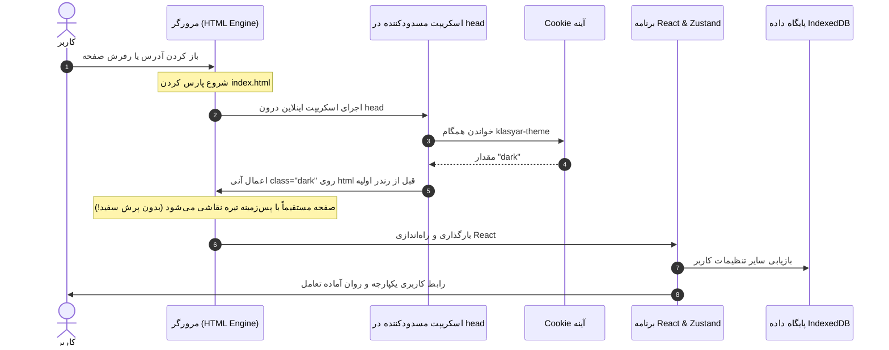

# پیاده‌سازی سیستم تم سه‌حالته (Dark / Light / System) بدون FOUC در برنامه‌های وب و دیتابیس‌های آفلاین

> **سطح:** متوسط  
> **پیش‌نیازها:** آشنایی با Tailwind CSS، معماری SPA، هوک‌های React و مفاهیم رندرینگ مرورگر  
> **کد مرجع در پروژه:** فایل ورودی [`index.html`](../../index.html)، ماژول مدیریت تم [`src/lib/theme.ts`](../../src/lib/theme.ts) و هوک [`src/hooks/use-theme.ts`](../../src/hooks/use-theme.ts)

---

## فهرست مطالب

1. [مقدمه: پدیده آزاردهنده پرش نور (FOUC) چیست؟](#۱-مقدمه-پدیده-آزاردهنده-پرش-نور-fouc-چیست)
2. [مسئله ویژه در برنامه‌های Offline-First با IndexedDB](#۲-مسئله-ویژه-در-برنامههای-offline-first-با-indexeddb)
3. [معماری برگزیده: الگوی آینه همگام با کوکی (Synchronous Cookie Mirror)](#۳-معماری-برگزیده-الگوی-آینه-همگام-با-کوکی-synchronous-cookie-mirror)
4. [راهکار گام‌به‌گام با کد واقعی پروژه](#۴-راهکار-گامبهگام-با-کد-واقعی-پروژه)
   - [گام ۱: اجرای اسکریپت همگام مسدودکننده در `<head>` صفحه `index.html`](#گام-۱-اجرای-اسکریپت-همگام-مسدودکننده-در-head-صفحه-indexhtml)
   - [گام ۲: ماژول تفکیک و اعمال تم در `src/lib/theme.ts`](#گام-۲-ماژول-تفکیک-و-اعمال-تم-در-srclibthemets)
   - [گام ۳: هوک واکنشی `useTheme` و گوش دادن به تغییرات سیستم‌عامل](#گام-۳-هوک-واکنشی-usetheme-و-گوش-دادن-به-تغییرات-سیستم‌عامل)
   - [گام ۴: همگام‌سازی استور Zustand و ذخیره دائمی در IndexedDB](#گام-۴-همگام‌سازی-استور-zustand-و-ذخیره-دائمی-در-indexeddb)
   - [گام ۵: طراحی مؤلفه رابط کاربری سوئیچ تم (`ThemeModeSwitch`)](#گام-۵-طراحی-مؤلفه-رابط-کاربری-سوئیچ-تم-thememodeswitch)
   - [گام ۶: پیکربندی متغیرهای CSS و Tailwind CSS](#گام-۶-پیکربندی-متغیرهای-css-و-tailwind-css)
5. [لینک به فایل‌های واقعی پروژه](#۵-لینک-به-فایلهای-واقعی-پروژه)
6. [جمع‌بندی و نکات کلیدی](#۶-جمعبندی-و-نکات-کلیدی)

---

## ۱. مقدمه: پدیده آزاردهنده پرش نور (FOUC) چیست؟

امروزه پشتیبانی از حالت تیره (Dark Mode)، حالت روشن (Light Mode) و حالت خودکار منطبق با سیستم‌عامل کاربر (System) یکی از استانداردهای اولیه هر محصول نرم‌افزاری است. اما اجرای غیراصولی آن در برنامه‌های تک‌صفحه‌ای (Single Page Applications یا SPA)، به پدیده‌ای به نام **FOUC** (کوتاه‌شده‌ی *Flash of Unstyled Content* یا در این حالت *Flash of White*) منجر می‌شود.

در حالت FOUC، وقتی کاربری که تم تیره را انتخاب کرده صفحه را Refresh می‌کند:
1. مرورگر صفحه سفید خالی را رندر می‌کند.
2. بسته‌های جاوااسکریپت دانلود و اجرا می‌شوند.
3. کد React بالا می‌آید و تم ذخیره‌شده را از دیتابیس می‌خواند.
4. کلاس `dark` به المان `<html>` اضافه می‌شود و صفحه تیره می‌گردد.

فاصله میان مرحله ۱ و ۴ (حتی ۵۰ تا ۱۰۰ میلی‌ثانیه)، باعث **یک پرش نور سفید شدید و آزاردهنده در چشمان کاربر** می‌شود که حس یک نرم‌افزار بی‌کیفیت و آماتور را القا می‌کند.



---

## ۲. مسئله ویژه در برنامه‌های Offline-First با IndexedDB

در پروژه‌های آنلاین ساده، معمولاً مقدار تم را در `localStorage` می‌گذارند. اما کلاس‌یار یک سامانه آفلاین و بدون سرور است و تمام تنظیمات کاربری (تم، فونت، تنظیمات اعلانات، نام کاربری و وضعیت نسخه پشتیبان) در **IndexedDB** ذخیره می‌شوند تا همراه دیتابیس پشتیبان‌گیری یا بازیابی شوند.

**مشکل کجاست؟**  
خواندن از IndexedDB **ذاتاً ناهمگام (Asynchronous)** است! یعنی تا زمانی که یک تراکنش در دیتابیس باز نشود و رویداد `onsuccess` فراخوانی نگردد، مقدار تم مشخص نیست. اگر بخواهیم تا باز شدن دیتابیس صبر کنیم، وقوع پرش نور سفید حتمی است!

---

## ۳. معماری برگزیده: الگوی آینه همگام با کوکی (Synchronous Cookie Mirror)

برای حل این معضل، کلاس‌یار از یک الگوی بسیار هوشمندانه به نام **«آینه همگام با کوکی»** استفاده می‌کند:
- **منبع اصلی حقیقت (Source of Truth):** همچنان جدول `settings` در IndexedDB و استور `Zustand` است.
- **آینه همگام:** هر زمان تم تغییر کند، مقداری به صورت آینه‌ای در یک کوکی کلاینتی بسیار سبک به نام `klasyar-theme` ذخیره می‌شود.
- **مزیت کوکی:** برخلاف IndexedDB، کوکی‌ها از طریق شیء استاندارد `document.cookie` در کسری از میلی‌ثانیه و به صورت کاملاً **همگام (Synchronous)** در دسترس هستند و نیاز به هیچ درخواستی به سرور ندارند.

---

## ۴. راهکار گام‌به‌گام با کد واقعی پروژه

### گام ۱: اجرای اسکریپت همگام مسدودکننده در `<head>` صفحه `index.html`

پیش از آنکه تگ `<body>` حتی ساخته شود یا اولین فریم CSS توسط مرورگر نقاشی شود، یک تابع اسکریپتی سبک درون `<head>` فایل [`index.html`](../../index.html) اجرا می‌شود:

```html
<!-- بخشی از فایل index.html -->
<!doctype html>
<html lang="fa" dir="rtl">
  <head>
    <meta charset="UTF-8" />
    <meta name="viewport" content="width=device-width, initial-scale=1.0" />
    <title>کلاس‌یار</title>

    <script>
      // پیش از رندر، تم ذخیره‌شده را اعمال می‌کنیم تا صفحه پرش نور نداشته باشد.
      // منبع اصلی تنظیمات IndexedDB است و خواندن همگام ندارد؛ این cookie فقط
      // یک آینه‌ی کوچک برای همین اسکریپت است.
      (function () {
        try {
          var match = document.cookie.match(
            /(?:^|;\s*)klasyar-theme=(light|dark|system)/,
          )
          var mode = match ? match[1] : "system"
          var isDark =
            mode === "dark" ||
            (mode === "system" &&
              window.matchMedia("(prefers-color-scheme: dark)").matches)

          // اعمال کلاس dark و استاندارد رنگی به المان ریشه html
          document.documentElement.classList.toggle("dark", isDark)
          document.documentElement.style.colorScheme = isDark ? "dark" : "light"
        } catch (e) {}
      })()
    </script>
  </head>
  <body>
    <div id="root"></div>
    <script type="module" src="/src/main.tsx"></script>
  </body>
</html>
```

#### چرا این اسکریپت FOUC را به صفر می‌رساند؟
چون اجرای این اسکریپت رشته رندر را مسدود (Render-Blocking) می‌کند و کلاس `dark` دقیقاً در همان لحظه ایجاد گره `<html>` به آن اضافه می‌شود. در نتیجه، اولین پیکسلی که روی صفحه نمایش ظاهر می‌شود، از قبل دارک است!

---

### گام ۲: ماژول تفکیک و اعمال تم در `src/lib/theme.ts`

در فایل [`src/lib/theme.ts`](../../src/lib/theme.ts)، منطق تم به توابع مستقل تقسیم شده است:

```typescript
// فایل src/lib/theme.ts
import type { ThemeMode } from "@/store/settingsStore"

export type ResolvedTheme = "light" | "dark"

export const THEME_HINT_COOKIE = "klasyar-theme"
const COOKIE_MAX_AGE_SECONDS = 60 * 60 * 24 * 365 // اعتبار ۱ سال

/** تشخیص تم سیستم‌عامل کاربر */
export function getSystemTheme(): ResolvedTheme {
  if (typeof window === "undefined" || typeof window.matchMedia !== "function") {
    return "light"
  }
  return window.matchMedia("(prefers-color-scheme: dark)").matches
    ? "dark"
    : "light"
}

/** تبدیل حالت system به مقدار قطعی light یا dark */
export function resolveTheme(theme: ThemeMode): ResolvedTheme {
  return theme === "system" ? getSystemTheme() : theme
}

/** کلاس dark و color-scheme را اعمال می‌کند و آینه‌ی cookie را به‌روز می‌کند. */
export function applyTheme(theme: ThemeMode): ResolvedTheme {
  const resolved = resolveTheme(theme)
  const root = document.documentElement

  root.classList.toggle("dark", resolved === "dark")
  root.style.colorScheme = resolved

  // ذخیره در کوکی با سیاست امنیتی Lax و مسیر ریشه
  document.cookie = `${THEME_HINT_COOKIE}=${theme}; path=/; max-age=${COOKIE_MAX_AGE_SECONDS}; SameSite=Lax`

  return resolved
}
```

---

### گام ۳: هوک واکنشی `useTheme` و گوش دادن به تغییرات سیستم‌عامل

هنگامی که کاربر حالت «سیستم» (System) را انتخاب کرده باشد، اگر سیستم‌عامل او در ساعت غروب آفتاب به طور خودکار به حالت Dark سوئیچ کند، برنامه باید فوراً بدون رفرش صفحه تیره شود. این کار در [`src/hooks/use-theme.ts`](../../src/hooks/use-theme.ts) پیاده شده است:

```typescript
// فایل src/hooks/use-theme.ts
import { useEffect, useState } from "react"
import { useSettingsHydrated } from "@/hooks/use-settings"
import { applyTheme, resolveTheme, type ResolvedTheme } from "@/lib/theme"
import { useSettingsStore, type ThemeMode } from "@/store/settingsStore"

interface UseThemeResult {
  theme: ThemeMode
  resolved: ResolvedTheme
  hydrated: boolean
}

export function useTheme(): UseThemeResult {
  const theme = useSettingsStore((state) => state.theme)
  const hydrated = useSettingsHydrated()
  const [resolved, setResolved] = useState<ResolvedTheme>(() =>
    resolveTheme(theme),
  )

  useEffect(() => {
    // تا پیش از بازخوانی تنظیمات، تم اولیه دست‌نخورده باقی می‌ماند
    if (!hydrated) return

    const media = window.matchMedia("(prefers-color-scheme: dark)")
    const sync = () => setResolved(applyTheme(theme))

    sync()

    // اگر تم دستی انتخاب شده باشد نیازی به شنود سیستم‌عامل نیست
    if (theme !== "system") return

    // شنود رویداد تغییر حالت تم در سیستم‌عامل کاربر
    media.addEventListener("change", sync)
    return () => media.removeEventListener("change", sync)
  }, [theme, hydrated])

  return { theme, resolved, hydrated }
}
```

---

### گام ۴: همگام‌سازی استور Zustand و ذخیره دائمی در IndexedDB

استور Zustand در [`src/store/settingsStore.ts`](../../src/store/settingsStore.ts) به عنوان لایه کش در حافظه (In-Memory State) عمل می‌کند و هر تغییری را به صورت ناهمگام در جدول `settings` پایگاه‌داده می‌نویسد:

```typescript
// بخشی از src/store/settingsStore.ts
export type ThemeMode = "light" | "dark" | "system"

interface SettingsState {
  theme: ThemeMode
  setTheme: (theme: ThemeMode) => Promise<void>
}

export const useSettingsStore = create<SettingsState>((set) => ({
  theme: "system",
  setTheme: async (theme) => {
    set({ theme })
    // اعمال فوری تم و ذخیره در کوکی آینه
    applyTheme(theme)
    // ذخیره دائمی در IndexedDB
    await setSetting("theme", theme)
  },
}))
```

---

### گام ۵: طراحی مؤلفه رابط کاربری سوئیچ تم (`ThemeModeSwitch`)

در کامپوننت [`src/components/settings/theme-mode-switch.tsx`](../../src/components/settings/theme-mode-switch.tsx)، گزینه‌های سه‌گانه با دکمه‌های شکیل، آیکون‌های استاندارد Lucide و پشتیبانی کامل از کیبورد ارائه شده‌اند:

```tsx
// بخشی از src/components/settings/theme-mode-switch.tsx
export function ThemeModeSwitch() {
  const theme = useSettingsStore((s) => s.theme)
  const setTheme = useSettingsStore((s) => s.setTheme)

  const options: { id: ThemeMode; label: string; icon: LucideIcon }[] = [
    { id: "light", label: "روشن", icon: Sun },
    { id: "dark", label: "تاریک", icon: Moon },
    { id: "system", label: "سیستم", icon: Laptop },
  ]

  return (
    <div className="flex items-center gap-1 rounded-xl border bg-card p-1 shadow-sm">
      {options.map(({ id, label, icon: Icon }) => (
        <button
          key={id}
          type="button"
          onClick={() => void setTheme(id)}
          className={cn(
            "flex items-center gap-2 rounded-lg px-3 py-1.5 text-xs font-bold transition-colors",
            theme === id
              ? "bg-primary text-primary-foreground shadow"
              : "text-muted-foreground hover:bg-muted/50 hover:text-foreground",
          )}
        >
          <Icon className="h-4 w-4" />
          {label}
        </button>
      ))}
    </div>
  )
}
```

---

### گام ۶: پیکربندی متغیرهای CSS و Tailwind CSS

در [`tailwind.config.ts`](../../tailwind.config.ts) حالت تیره بر اساس کلاس ریشه تنظیم شده است:

```typescript
export default {
  darkMode: ["class"],
  // ...
}
```

و در فایل سراسری CSS متغیرهای رنگی HSL برای حالت عادی و `.dark` تفکیک شده‌اند تا تمام مؤلفه‌های طراحی بدون نیاز به کدهای تکراری جاوااسکریپتی به طور کامل تغییر رنگ دهند.

---

## ۵. لینک به فایل‌های واقعی پروژه

- اسکریپت مسدودکننده ضد FOUC در هدر صفحه: [`index.html`](../../index.html)
- ماژول اعمال تم و آینه همگام کوکی: [`src/lib/theme.ts`](../../src/lib/theme.ts)
- هوک واکنشی تغییر تم و شنود سیستم‌عامل: [`src/hooks/use-theme.ts`](../../src/hooks/use-theme.ts)
- استور سراسری تنظیمات در Zustand: [`src/store/settingsStore.ts`](../../src/store/settingsStore.ts)
- کامپوننت رابط کاربری سوئیچ تم: [`src/components/settings/theme-mode-switch.tsx`](../../src/components/settings/theme-mode-switch.tsx)
- تنظیمات رنگ‌ها و استایل‌ها در Tailwind: [`tailwind.config.ts`](../../tailwind.config.ts)

---

## ۶. جمع‌بندی و نکات کلیدی

1. **ریشه FOUC در ناهمگام بودن است:** هرگز برای تعیین تم اولیه منتظر هوک‌های React، دریافت پاسخ از دیتابیس یا استورهای Async نمانید.
2. **قدرت اسکریپت‌های درون `<head>`:** با اجرای یک خط اسکریپت خالص جاوااسکریپت قبل از رندر درخت DOM، ظاهر تم بدون کمترین پرش نور تثبیت می‌شود.
3. **الگوی آینه همگام با کوکی:** به جای تنزل معماری دیتابیس یا پخش کردن داده‌ها در چند مخزن، از یک کوکی سبک صرفاً به عنوان بازتاب سریع تنظیمات استفاده کنید.
4. **شنود هوشمندانه `prefers-color-scheme`:** تنظیم رویداد `change` در حالت "system" تجربه‌ای بی‌نقص و مدرن به کاربران ارائه می‌دهد.
