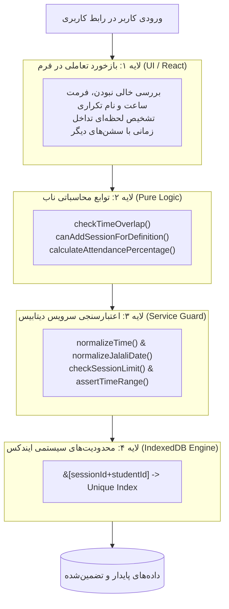

# الگوهای اعتبارسنجی در فرم‌ها و قوانین کسب‌وکار (معماری دفاع در عمق)

> **سطح:** متوسط تا پیشرفته  
> **پیش‌نیازها:** آشنایی با کامپوننت‌های فرم در React، اعتبارسنجی داده‌ها و منطق تجاری (Business Logic)  
> **کد مرجع در پروژه:** ماژول منطق تجاری خالص [`src/lib/pure-logic.ts`](../../src/lib/pure-logic.ts)، فرم کلاس‌ها [`src/components/classes/class-form-dialog.tsx`](../../src/components/classes/class-form-dialog.tsx) و فرم جلسات [`src/components/sessions/session-form-dialog.tsx`](../../src/components/sessions/session-form-dialog.tsx)

---

## فهرست مطالب

1. [مقدمه: چرا اعتبارسنجی سطحی در فرم‌ها کافی نیست؟](#۱-مقدمه-چرا-اعتبارسنجی-سطحی-در-فرمها-کافی-نیست)
2. [مسئله: چالش‌های یکپارچگی داده و اعتبارسنجی در کلاس‌یار](#۲-مسئله-چالشهای-یکپارچگی-داده-و-اعتبارسنجی-در-کلاسیار)
3. [معماری دفاع در عمق (Defense in Depth)](#۳-معماری-دفاع-در-عمق-defense-in-depth)
4. [راهکار گام‌به‌گام با کد واقعی پروژه](#۴-راهکار-گامبهگام-با-کد-واقعی-پروژه)
   - [گام ۱: تفکیک توابع منطق تجاری خالص (Pure Business Logic)](#گام-۱-تفکیک-توابع-منطق-تجاری-خالص-pure-business-logic)
   - [گام ۲: اعتبارسنجی تعاملی و فوری در فرم‌های React](#گام-۲-اعتبارسنجی-تعاملی-و-فوری-در-فرمهای-react)
   - [گام ۳: شناسایی تداخل زمانی و چک سقف ظرفیت قبل از سابمیت](#گام-۳-شناسایی-تداخل-زمانی-و-چک-سقف-ظرفیت-قبل-از-سابمیت)
   - [گام ۴: اعتبارسنجی ثانویه در لایه ذخیره‌سازی و سرویس پایگاه‌داده](#گام-۴-اعتبارسنجی-ثانویه-در-لایه-ذخیرهسازی-و-سرویس-پایگاهداده)
   - [گام ۵: محدودیت‌های سخت‌افزاری در سطح ایندکس‌های دیتابیس (Compound Unique Constraints)](#گام-۵-محدودیتهای-سختافزاری-در-سطح-ایندکسهای-دیتابیس-compound-unique-constraints)
   - [گام ۶: مدیریت و نگاشت خطاها با `DatabaseError`](#گام-۶-مدیریت-و-نگاشت-خطاها-با-databaseerror)
5. [لینک به فایل‌های واقعی پروژه](#۵-لینک-به-فایلهای-واقعی-پروژه)
6. [جمع‌بندی و نکات کلیدی](#۶-جمعبندی-و-نکات-کلیدی)

---

## ۱. مقدمه: چرا اعتبارسنجی سطحی در فرم‌ها کافی نیست؟

در توسعه رابط کاربری وب، رایج‌ترین اشتباه این است که توسعه‌دهنده صرفاً با غیرفعال کردن یک دکمه (`disabled={!isValid}`) یا گذاشتن یک فیلتر ساده در رویداد `onSubmit` کار را تمام‌شده می‌داند.

اما در دنیای واقعی:
- کاربر ممکن است با کلید Enter فرم را سابمیت کند.
- تغییرات غیرهمگام (مانند دو درخواست همزمان در دو تب مختلف مرورگر) می‌توانند اعتبارسنجی اولیه را دور بزنند.
- اگر منطق اعتبارسنجی با مؤلفه‌های UI گره خورده باشد، تست کردن آن نیازمند رندر کردن کل درخت DOM خواهد بود و تست‌های واحد (Unit Tests) کند یا غیرممکن می‌شوند.
- ذخیره شدن حتی یک رکورد نامعتبر (مانند ساعت پایان قبل از ساعت شروع، یا ثبت دو حضور همزمان برای یک دانش‌آموز) می‌تواند کل محاسبات آماری، تقویم و گزارش‌های مالی/آموزشی را فاسد کند.

استراتژی **دفاع در عمق (Defense in Depth)** بیان می‌کند که اعتبارسنجی و قوانین کنترل دسترسی/یکپارچگی باید در تمام لایه‌های برنامه (از ورودی کاربر گرفته تا موتور ذخیره‌سازی) تکرار و تضمین شوند.



---

## ۲. مسئله: چالش‌های یکپارچگی داده و اعتبارسنجی در کلاس‌یار

در کلاس‌یار با سناریوهای مهمی از قوانین کسب‌وکار مواجه هستیم:
1. **قانون تداخل زمانی (Time Overlap):** هیچ استادی نباید بتواند دو جلسه هم‌زمان در یک روز داشته باشد (مثلاً کلاس ۱ از ساعت ۱۶:۰۰ تا ۱۷:۳۰ و کلاس ۲ از ۱۷:۰۰ تا ۱۸:۳۰). با این حال، جلسات چسبیده به هم (Back-to-Back مانند ۱۶:۰۰ تا ۱۷:۳۰ و سپس ۱۷:۳۰ تا ۱۹:۰۰) کاملاً مجاز هستند.
2. **قانون سقف جلسات (Session Limit):** اگر یک دوره آموزشی برای ۱۲ جلسه تعریف شده است، سیستم نباید اجازه ثبت جلسه سیزدهم را بدهد؛ مگر اینکه کاربر سقف دوره را افزایش دهد.
3. **قانون توالی زمانی (Chronological Sequence):** ساعت شروع باید اکیداً قبل از ساعت پایان باشد (`start < end`).
4. **قانون عدم ثبت تکراری حضور:** در یک جلسه معین، یک دانش‌آموز نمی‌تواند هم حاضر و هم غایب ثبت شود.

---

## ۳. معماری دفاع در عمق (Defense in Depth)

برای تضمین ۱۰۰ درصدی سلامت داده‌ها، کلاس‌یار از یک الگوی ۴ لایه‌ای استفاده می‌کند:
- **لایه توابع خالص (Pure Logic):** بدون وابستگی به React یا Dexie؛ با تست‌های واحد فوق‌سریع.
- **لایه فرم و تجربه کاربری (UI Feedback):** نمایش هشدارها، پایش همپوشانی‌ها و غیرفعال‌سازی هوشمند.
- **لایه سرویس دیتابیس (Service Guards):** نرمال‌سازی داده‌ها و پرتاب خطاهای اختصاصی `DatabaseError`.
- **لایه ایندکس دیتابیس (DB Engine Unique Index):** مسدودسازی فیزیکی ثبت رکوردهای تکراری در مرورگر.

---

## ۴. راهکار گام‌به‌گام با کد واقعی پروژه

### گام ۱: تفکیک توابع منطق تجاری خالص (Pure Business Logic)

در فایل [`src/lib/pure-logic.ts`](../../src/lib/pure-logic.ts)، توابعی پیاده شده‌اند که هیچ وابستگی به کتابخانه‌های خارجی ندارند و خروجی آن‌ها صرفاً تابع ورودی‌هایشان است (توابع ریاضی و قطعی):

```typescript
// بخشی از فایل src/lib/pure-logic.ts

export interface TimeInterval {
  start: string // HH:MM
  end: string   // HH:MM
}

/**
 * بررسی تداخل و هم‌پوشانی دو بازه زمانی در یک روز [start, end)
 * توجه: جلسات پشت‌سرهم (Back-to-Back مانند ۱۰:۰۰ تا ۱۱:۳۰ و ۱۱:۳۰ تا ۱۳:۰۰) تداخل ندارند.
 */
export function checkTimeOverlap(a: TimeInterval, b: TimeInterval): boolean {
  if (a.start >= a.end || b.start >= b.end) return false
  // بازه‌ها همپوشانی دارند اگر و تنها اگر: a.start < b.end && b.start < a.end
  return a.start < b.end && b.start < a.end
}

/**
 * اعتبارسنجی سقف جلسات یک کلاس
 */
export function canAddSessionForDefinition(
  currentCount: number,
  totalSessions: number,
): boolean {
  if (totalSessions <= 0) return false
  return currentCount < totalSessions
}

/**
 * محاسبه درصد حضور (شاگرد یا میانگین کل کلاس)
 */
export function calculateAttendancePercentage(
  present: number,
  late: number,
  excused: number,
  absent: number,
): number | null {
  const p = Math.max(0, present)
  const l = Math.max(0, late)
  const e = Math.max(0, excused)
  const a = Math.max(0, absent)

  const recordedTotal = p + l + e + a
  if (recordedTotal === 0) return null

  const attended = p + l
  return Math.round((attended / recordedTotal) * 100)
}
```

#### تست‌پذیری در بالاترین سطح:
به فایل تست واقعی [`src/test/pure-logic.test.ts`](../../src/test/pure-logic.test.ts) نگاه کنید؛ این توابع ظرف کمتر از ۱۰ میلی‌ثانیه بدون نیاز به شبیه‌سازی DOM یا Mock دیتابیس به صورت ۱۰۰٪ تست می‌شوند:

```typescript
// بخشی از src/test/pure-logic.test.ts
describe("checkTimeOverlap", () => {
  it("جلسات پشت‌سرهم (Back-to-Back) را تداخل تشخیص نمی‌دهد", () => {
    const a = { start: "10:00", end: "11:30" }
    const b = { start: "11:30", end: "13:00" }
    expect(checkTimeOverlap(a, b)).toBe(false)
  })

  it("هم‌پوشانی جزئی را به درستی تداخل اعلام می‌کند", () => {
    const a = { start: "10:00", end: "12:00" }
    const b = { start: "11:00", end: "13:00" }
    expect(checkTimeOverlap(a, b)).toBe(true)
  })
})
```

---

### گام ۲: اعتبارسنجی تعاملی و فوری در فرم‌های React

در فرم کلاس‌ها ([`src/components/classes/class-form-dialog.tsx`](../../src/components/classes/class-form-dialog.tsx))، کاربر به محض تایپ کردن، بازخورد می‌گیرد:

```typescript
// بررسی آنی نام تکراری کلاس
const trimmedTitle = title.trim()
const duplicateTitle = useMemo(() => {
  if (!trimmedTitle) return false
  const target = trimmedTitle.toLocaleLowerCase("fa")
  return definitions.some(
    (item) =>
      item.id !== definition?.id &&
      item.title.trim().toLocaleLowerCase("fa") === target,
  )
}, [definitions, definition?.id, trimmedTitle])
```

و در زمان ارسال فرم:

```typescript
const handleSubmit = async (event: FormEvent<HTMLFormElement>) => {
  event.preventDefault()
  setError(null)

  const parsedSessions = Number(totalSessions)

  if (!trimmedTitle) {
    setError("عنوان کلاس الزامی است.")
    return
  }
  if (days.length === 0) {
    setError("حداقل یک روز هفته را انتخاب کنید.")
    return
  }
  if (
    !Number.isInteger(parsedSessions) ||
    parsedSessions < 1 ||
    parsedSessions > MAX_TOTAL_SESSIONS
  ) {
    setError(`تعداد جلسات باید عددی صحیح بین ۱ تا ${MAX_TOTAL_SESSIONS} باشد.`)
    return
  }
  if (start >= end) {
    setError("ساعت پایان باید بعد از ساعت شروع باشد.")
    return
  }
  // ذخیره در صورت معتبر بودن...
}
```

---

### گام ۳: شناسایی تداخل زمانی و چک سقف ظرفیت قبل از سابمیت

در فرم جلسات ([`src/components/sessions/session-form-dialog.tsx`](../../src/components/sessions/session-form-dialog.tsx))، تداخل زمانی به صورت زنده با کوئری دیتابیس رصد می‌شود:

```typescript
// پایش هم‌پوشانی ساعت جلسه با سایر جلسات در همان روز
useEffect(() => {
  if (!date || !start || !end || start >= end) {
    setOverlapping(null)
    return
  }

  let active = true
  findOverlappingSession(date, start, end, session?.id)
    .then((res) => {
      if (active) setOverlapping(res ?? null)
    })
    .catch(() => {
      if (active) setOverlapping(null)
    })

  return () => {
    active = false
  }
}, [date, start, end, session?.id])
```

اگر تداخلی وجود داشته باشد، فرم با یک پیام هشدار قرمز رنگ به کاربر اطلاع می‌دهد که این جلسه با کدام کلاس تداخل دارد و دکمه تایید را غیرفعال می‌کند:

```tsx
{overlapping ? (
  <div role="alert" className="flex items-center gap-2 rounded-xl bg-destructive/10 p-3 text-xs text-destructive">
    <TriangleAlert className="h-4 w-4 shrink-0" />
    <span>
      این بازه زمانی با {conflictingClass ? `کلاس «${conflictingClass.title}»` : "جلسه دیگری"}
      در ساعت {overlapping.start} تا {overlapping.end} تداخل دارد.
    </span>
  </div>
) : null}
```

---

### گام ۴: اعتبارسنجی ثانویه در لایه ذخیره‌سازی و سرویس پایگاه‌داده

حتی اگر کسی دکمه سابمیت را از Developer Tools فعال کند، لایه سرویس در [`src/db/sessions.ts`](../../src/db/sessions.ts) مجدداً تمام اعتبارسنجی‌ها را اجرا می‌کند:

```typescript
// بخشی از src/db/sessions.ts
export async function createSession(input: CreateSessionInput): Promise<Session> {
  const definition = await db.classDefinitions.get(input.definitionId)
  if (!definition) {
    throw new DatabaseError("not-found", "کلاس انتخاب‌شده یافت نشد.")
  }

  const date = normalizeJalaliDate(input.date)
  const start = normalizeTime(input.start ?? definition.defaultStart)
  const end = normalizeTime(input.end ?? definition.defaultEnd)
  assertTimeRange(start, end)

  // اعتبارسنجی مجدد سقف جلسات
  const limitInfo = await checkSessionLimit(definition.id)
  if (limitInfo.isFull) {
    throw new DatabaseError(
      "conflict",
      `سقف جلسات این کلاس تکمیل شده است (${limitInfo.count} از ${limitInfo.total} جلسه ثبت شده).`,
    )
  }

  // اعتبارسنجی مجدد تداخل زمانی
  const overlapping = await findOverlappingSession(date, start, end)
  if (overlapping) {
    const conflictingClass = await db.classDefinitions.get(overlapping.definitionId)
    const className = conflictingClass ? `کلاس «${conflictingClass.title}»` : "جلسه دیگری"
    throw new DatabaseError(
      "conflict",
      `این بازه زمانی با ${className} در ساعت ${overlapping.start} تا ${overlapping.end} تداخل دارد.`,
    )
  }

  // ایجاد رکورد ایمن...
}
```

---

### گام ۵: محدودیت‌های سخت‌افزاری در سطح ایندکس‌های دیتابیس (Compound Unique Constraints)

پایین‌ترین لایه دفاعی، ایندکس یکتای پایگاه‌داده در [`src/db/schema.ts`](../../src/db/schema.ts) است:

```typescript
this.version(DB_VERSION).stores({
  // ایندکس ترکیبی یکتا: ثبت تکراری حضور یک دانش‌آموز در یک جلسه غیرممکن است
  attendance: "id, sessionId, studentId, status, &[sessionId+studentId]",
})
```

علامت `&` به موتور IndexedDB مرورگر اعلام می‌کند که مقدار مرکب `sessionId + studentId` باید در کل جدول منحصر به فرد باشد. اگر دو تراکنش همزمان قصد درج رکورد تکراری داشته باشند، پایگاه داده با خطای `ConstraintError` مانع از فاسد شدن داده‌ها می‌شود.

---

### گام ۶: مدیریت و نگاشت خطاها با `DatabaseError`

کلاس خطای سفارشی در [`src/db/errors.ts`](../../src/db/errors.ts) تمامی خطاهای سیستمی، اعتبارسنجی، تداخل و عدم یافتن رکورد را کپسوله می‌کند:

```typescript
// فایل src/db/errors.ts
export type DatabaseErrorKind =
  | "validation"
  | "not-found"
  | "conflict"
  | "quota"
  | "unknown"

export class DatabaseError extends Error {
  readonly kind: DatabaseErrorKind

  constructor(kind: DatabaseErrorKind, message: string, options?: ErrorOptions) {
    super(message, options)
    this.name = "DatabaseError"
    this.kind = kind
  }
}
```

هنگام وقوع خطا، متد `getDatabaseErrorMessage` پیام مناسب و شفاف را در توئست (Toast) یا جعبه هشدار دیالوگ به زبان فارسی نمایش می‌دهد.

---

## ۵. لینک به فایل‌های واقعی پروژه

- توابع منطق تجاری ناب و تست‌پذیر: [`src/lib/pure-logic.ts`](../../src/lib/pure-logic.ts)
- مجموعه تست‌های واحد قوانین تجاری: [`src/test/pure-logic.test.ts`](../../src/test/pure-logic.test.ts)
- فرم ایجاد و ویرایش کلاس با اعتبارسنجی نام تکراری: [`src/components/classes/class-form-dialog.tsx`](../../src/components/classes/class-form-dialog.tsx)
- فرم مدیریت جلسه با تشخیص بی‌درنگ تداخل زمانی: [`src/components/sessions/session-form-dialog.tsx`](../../src/components/sessions/session-form-dialog.tsx)
- سرویس جلسات و اعتبارسنجی مجدد لایه دیتابیس: [`src/db/sessions.ts`](../../src/db/sessions.ts)
- تعاریف اسکیمای ایندکس‌ها و اعتبارسنجی تاریخ/ساعت: [`src/db/schema.ts`](../../src/db/schema.ts)
- سیستم خطاها و کلاس DatabaseError: [`src/db/errors.ts`](../../src/db/errors.ts)

---

## ۶. جمع‌بندی و نکات کلیدی

1. **جداسازی توابع خالص:** منطق محاسباتی (مانند تشخیص تداخل یا سقف کلاس) را همیشه در ماژول‌های مستقل و فاقد وابستگی به فریم‌ورک پیاده کنید تا تست واحد آن‌ها سریع، ارزان و بی‌نقص باشد.
2. **اعتبارسنجی تعاملی در لایه UI:** بازخورد بی‌درنگ قبل از فشردن دکمه سابمیت (مانند نمایش کلاس متداخل)، تجربه کاربری را از حالت ناامیدکننده به یک سیستم هوشمند ارتقا می‌دهد.
3. **اعتبارسنجی لایه دیتابیس هرگز حذف نمی‌شود:** هرگز به اعتبارسنجی فرم کلاینت اعتماد ۱۰۰٪ نکنید؛ متدهای سرویس همیشه ورودی‌ها را نرمال‌سازی و بازبینی می‌کنند.
4. **تضمین سلامت با Unique Constraint:** استفاده از ایندکس‌های ترکیبی یکتا مانند `&[sessionId+studentId]` تضمین می‌کند حتی در صورت بروز باگ در کد، دیتابیس هرگز داده آلوده ذخیره نخواهد کرد.
