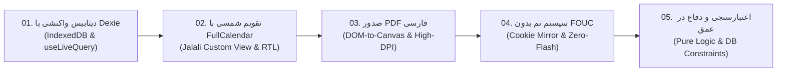

# مقالات آموزشی عمیق کدبیس کلاس‌یار (Deep-Dive Tutorials)

به بخش آموزش‌های معماری و مهندسی نرم‌افزار **کلاس‌یار (KlasYar)** خوش آمدید!  
این مجموعه مقالات آموزشی با هدف تبدیل این پروژه متن‌باز به یک **منبع یادگیری کاربردی و عمیق** برای توسعه‌دهندگان فرانت‌اند، مهندسان React و علاقه‌مندان به معماری‌های محلی و بدون سرور (Local-First / Offline-First) نگارش شده است.

هر مقاله یک مفهوم واقعی و چالش‌برانگیز در دنیای واقعی مهندسی وب را با استناد مستقیم به کدهای موجود در همین مخزن آموزش می‌دهد.

---

## فهرست مقالات آموزشی

| شماره | عنوان مقاله | موضوع کلیدی | فایل مقاله |
| :---: | :--- | :--- | :--- |
| **۰۱** | **آموزش IndexedDB از صفر تا `useLiveQuery`** | دیتابیس کلاینت‌ساید، ایندکس‌های ترکیبی و یکتا، اتصال واکنشی دیتابیس به رندر React بدون Redux | [01-indexeddb-with-dexie.md](./01-indexeddb-with-dexie.md) |
| **۰۲** | **چطور FullCalendar را با تاریخ شمسی راه بیندازیم؟** | پیاده‌سازی گاه‌شماری جلالی در FullCalendar با نمای سفارشی، شروع هفته از شنبه، جهت RTL و چیپ رویدادها | [02-jalali-calendar.md](./02-jalali-calendar.md) |
| **۰۳** | **چالش تولید PDF فارسی در وب و راه‌حل کامل** | رفع معضل حروف جدا و معکوس فارسی در کلاینت، تعبیه فونت وزیرمتن، چاپ با کیفیت رتینا و خروجی ماتریسی | [03-persian-pdf-export.md](./03-persian-pdf-export.md) |
| **۰۴** | **پیاده‌سازی Dark/Light/System بدون FOUC** | سیستم تم سه‌حالته، جلوگیری از پرش نور سفید با الگوی آینه همگام کوکی و اسکریپت مسدودکننده در `<head>` | [04-theme-system.md](./04-theme-system.md) |
| **۰۵** | **الگوهای اعتبارسنجی در فرم‌ها و قوانین کسب‌وکار** | معماری دفاع در عمق، توابع منطق محاسباتی خالص، پایش تداخل زمانی جلسات و ایندکس یکتای پایگاه‌داده | [05-rbac-and-validation.md](./05-rbac-and-validation.md) |

---

## ساختار استاندارد مقالات

تمامی مقالات این مجموعه از ساختار ۵ گام استاندارد زیر پیروی می‌کنند:
1. **مقدمه (Introduction):** طرح مبحث، اهمیت و پیش‌نیازها.
2. **مسئله (The Problem):** شرح چالش‌های واقعی در وب و چرایی شکست راه‌حل‌های سطحی.
3. **راه‌حل گام‌به‌گام با کد (Step-by-Step Solution):** قطعه کدهای واقعی، مدل‌سازی معماری و جزئیات پیاده‌سازی.
4. **لینک به فایل‌های واقعی پروژه (Code References):** پیوندهای مستقیم و کلیک‌پذیر به سورس‌کدهای مخزن.
5. **جمع‌بندی و نکات کلیدی (Key Takeaways):** چک‌لیست کاربردی برای استفاده در پروژه‌های شرکتی و شخصی شما.

---

> برای آشنایی با معماری کلان، راهنمای استقرار و مدل‌های داده، حتماً [راهنمای جامع توسعه‌دهندگان](../developer-guide.md) و [سند معماری](../architecture.md) را نیز مطالعه فرمایید.
